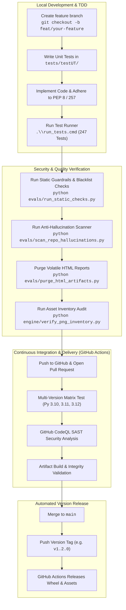

# Contributing to BeRightVGC / Coach Porygon VGC

Welcome to the **BeRightVGC** open-source contributor community! We are engineering an autonomous coaching, scouting, and deterministic turn-simulation platform for the **Pokémon Champions (Regulation M-C)** competitive format, maintained by **esquedev**.

Whether you are an elite VGC competitor, a prompt engineer, a front-end UI designer, or a systems Python developer, your contributions help make high-level competitive coaching accessible, mathematically verified, and free of hallucinations.

---

## 🗺️ 1. Architecture & Software Delivery Lifecycle (SDLC)

Our repository enforces a clean separation of concerns, zero runtime dependencies for the core engine, and an automated continuous delivery pipeline:



---

## 🎯 2. High-Impact Contribution Opportunities ("Where You Can Help")

We have structured the codebase so contributors can make immediate, high-value impacts across multiple domains:

| Track | Impact Domain | Target Files | Difficulty | Description |
| :---: | :--- | :--- | :---: | :--- |
| ⚔️ | **Board Sparring Flashcards (Mode 3)** | [`engine/scenarios_data.py`](engine/scenarios_data.py) | **Easy** | Author new 45-second high-pressure turn puzzles (Weather wars, Trick Room vs Tailwind, Perish Song traps, Unburden setups). |
| ⚡ | **Speed Duel Flashcards (Mode 3)** | [`engine/speed_duels_data.py`](engine/speed_duels_data.py) | **Easy** | Add new Level 50 speed tier matchups and priority bracket showdowns with detailed competitive explanations. |
| 🏆 | **Metagame Regulation Adaptors** | [`data/MC_Available_Pokemon.csv`](data/MC_Available_Pokemon.csv), [`engine/validate_roster.py`](engine/validate_roster.py) | **Medium** | Extend format legality checkers for upcoming tournament rulesets and regional championships. |
| 📊 | **GPU Tensor Optimization & Nash Payoffs** | [`engine/gpu/`](engine/gpu/), [`engine/tactics/`](engine/tactics/) | **Hard** | Enhance simultaneous $5 \times 5$ tensor batching, HiGHS LP solver latency, and counterfactual equity calculations. |
| 🎥 | **Broadcasting & Caster Aid Overlays** | [`engine/caster_dossier.py`](engine/caster_dossier.py), [`engine/ui_server.py`](engine/ui_server.py) | **Medium** | Create and enhance print-ready A4 caster cheat sheets and streaming widgets for tournament commentators. |
| 🎨 | **Command Center UI Themes** | [`assets/command_center.html`](assets/command_center.html) | **Medium** | Implement alternative visual colorways (Midnight Cyber, High-Contrast, Retro GameBoy) in the standalone frontend. |
| 🌐 | **Internationalization (i18n)** | [`engine/update_command_center.py`](engine/update_command_center.py) | **Medium** | Translate scenario descriptions, error codes, and tactical debriefs into Japanese (`ja`), French (`fr`), and German (`de`). |
| 🛡️ | **Adversarial Evaluator Cases** | [`evals/stress_cases.yaml`](evals/stress_cases.yaml) | **Hard** | Design new adversarial stress test prompts to probe model adherence against OWASP LLM01 injection vectors. |

---

## 💻 3. Development Setup & Workflow

### Prerequisites
- Python 3.10, 3.11, or 3.12 installed.
- Git.

### 1. Clone & Set Up Development Dependencies
```bash
git clone https://github.com/esquedev/coach-porygon-vgc.git
cd coach-porygon-vgc

# Create and activate virtual environment
python -m venv .venv

# Windows:
.venv\Scripts\activate
# macOS / Linux:
source .venv/bin/activate

# Install developer dependencies:
pip install -r requirements-dev.txt
```

### 2. Configure Git Pre-Push Hooks
To ensure your branch meets all release criteria before pushing:
```bash
# Windows / POSIX:
git config core.hooksPath .githooks
```

---

## 🧪 4. Local Testing & Verification

Before submitting a Pull Request, verify that all 5 CI/CD phases pass locally:

```bash
# Windows:
.\run_tests.cmd

# macOS / Linux:
./run_tests.sh
```

### Running Targeted Tests
```bash
# Execute unit tests only:
pytest tests/testUT/

# Execute acceptance tests only:
pytest tests/testAT/

# Run the repo-wide anti-hallucination scanner:
python evals/scan_repo_hallucinations.py

# Run static guardrail checks:
python evals/run_static_checks.py
```

---

## 📐 5. Code Style & Engineering Standards

1. **Deterministic Core:** `engine/turn_simulator.py` and `engine/sp_calculator.py` must never depend on third-party web frameworks, HTTP libraries, or generative APIs. They must remain pure mathematical engines.
2. **Canonical Terminology:** Always use **Trainer** (EN) or **Entrenador** (ES). Never use aviation terms like `pilot` or `piloto`.
3. **Regulation M-C Species Lock:** Never suggest, evaluate, or include species on the Regulation M-C blacklist (`Flutter Mane`, `Urshifu`, `Ursaluna`, `Amoonguss`, `Chi-Yu`, etc.). Any unflagged mention is treated as an illegal hallucination.
4. **PEP 8 & Type Hints:** All Python code must strictly pass `flake8` / `pycodestyle` with line length $\le 160$ and include PEP 484 type hints.

---

## 🏷️ 6. Branching Strategy & Submitting Pull Requests

1. **Branch Naming:**
   - Features: `feat/short-description`
   - Bug fixes: `fix/short-description`
   - Documentation: `docs/short-description`
2. **Commit Messages:**
   Use Conventional Commits: `feat:`, `fix:`, `docs:`, `refactor:`, `test:`, `chore:`.
3. **Pull Request Checklist:**
   - [ ] Unit tests added for any new engine logic.
   - [ ] All 247 tests pass via `pytest tests/`.
   - [ ] `evals/scan_repo_hallucinations.py` reports 0 violations.
   - [ ] Documentation updated to reflect changes.

---

<div align="center">
  <sub>Thank you for building the future of deterministic esports coaching with <b>esquedev</b>!</sub>
</div>
