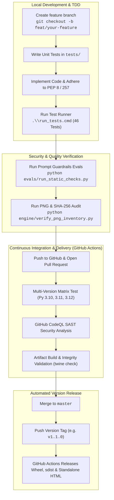

# Contributing to Coach Porygon VGC

Welcome to the **Coach Porygon VGC** open-source contributor community! We are building an autonomous coaching, scouting, and deterministic turn-simulation platform for the **Pokémon Champions (Regulation M-C)** competitive format.

Whether you are a competitive VGC player, a prompt engineer, a front-end UI designer, or a backend Python developer, your contributions help make high-level competitive coaching accessible, mathematically verified, and free of hallucinations.

---

## 🗺️ 1. Architecture & Software Delivery Lifecycle (SDLC)

Our repository enforces a clean separation of concerns, zero runtime dependencies for the core engine, and an automated continuous delivery pipeline:



---

## 🎯 2. High-Impact Contribution Opportunities ("Where You Can Help")

We have structured the codebase so contributors can make immediate, high-value impacts across multiple domains:

| Track | Impact Domain | Target Files | Difficulty | Description |
| :---: | :--- | :--- | :---: | :--- |
| ⚔️ | **Board Sparring Flashcards (Mode 3)** | [`engine/scenarios_data.py`](engine/scenarios_data.py) | **Easy** | Author new 45-second high-pressure turn puzzles (Weather wars, Trick Room vs Tailwind, Perish Song traps, Unburden setups). |
| ⚡ | **Speed Duel Flashcards (Mode 3)** | [`engine/speed_duels_data.py`](engine/speed_duels_data.py) | **Easy** | Add new Level 50 speed tier matchups and priority bracket showdowns with detailed competitive explanations. |
| 🏆 | **Metagame Regulation Adaptors** | [`data/MC_Available_Pokemon.csv`](data/MC_Available_Pokemon.csv), [`engine/validate_roster.py`](engine/validate_roster.py) | **Medium** | Extend format legality checkers for upcoming tournament rulesets and regional championships. |
| 📊 | **Win-Rate Machine Learning** | [`engine/telemetry.py`](engine/telemetry.py), [`data/Raw_Matches.csv`](data/Raw_Matches.csv) | **Medium** | Train local scikit-learn / XGBoost classifiers to predict real-time Victory Point (VP) inflection points and live win percentages. |
| 🎥 | **Broadcasting & Streaming Overlays** | [`engine/ui_server.py`](engine/ui_server.py) | **Medium** | Create an OBS Studio browser source widget that reads `http://127.0.0.1:8000/api/telemetry` to display live speed tiers on stream. |
| 🎨 | **Command Center UI Themes** | [`assets/command_center.html`](assets/command_center.html) | **Medium** | Implement alternative visual colorways (Dark Mode, Accessible High-Contrast, Retro GameBoy) in the standalone frontend. |
| 🌐 | **Internationalization (i18n)** | [`engine/update_command_center.py`](engine/update_command_center.py) | **Medium** | Translate scenario descriptions, error codes, and tactical debriefs into Japanese (`ja`), French (`fr`), and German (`de`). |
| 🛡️ | **Adversarial Evaluator Cases** | [`evals/stress_cases.yaml`](evals/stress_cases.yaml) | **Hard** | Design new adversarial stress test prompts to probe model adherence against OWASP LLM01 injection vectors. |

---

## 💻 3. Development Setup & Workflow

### Prerequisites
- Python 3.10, 3.11, or 3.12 installed on your machine.
- Git.

### 1. Clone & Set Up Development Dependencies
```bash
git clone https://github.com/unkil/coach-porygon-vgc.git
cd coach-porygon-vgc

# Optional: Create and activate virtual environment
python -m venv .venv
# Windows:
.venv\Scripts\activate
# macOS / Linux:
source .venv/bin/activate

# Install developer, testing, and linting tools:
pip install -r requirements-dev.txt
```

### 2. Run the Verification & Test Suite
Every commit must pass all 46 tests:
```bash
# On Windows (Automated ANSI colored runner):
.\run_tests.cmd

# Cross-Platform / macOS / Linux:
python tests/run_all_tests.py
```

### 3. Verify Backend-to-Frontend Integration
```bash
python -m unittest tests/testAT/engine/test_UiServerEndpoints.py
```

---

## 📐 4. Mechanical Rules & Coding Standards

Every contribution affecting calculations, coaching output, or team validation **must adhere strictly to Regulation M-C rules**:

### A. 66-Stat-Point (SP) Budget & Showdown EV Equivalence
* Maximum **66 SP** across all 6 stats combined (`HP`, `Atk`, `Def`, `SpA`, `SpD`, `Spe`).
* Maximum **32 SP** in any single stat.
* **Exact Showdown Bijective Mapping:**
  * Formula (SP to EV): `EV = 4 + (SP - 1) × 8` (for `SP ≥ 1`)
  * Formula (EV to SP): `SP = 1 + ⌊(EV - 4) / 8⌋` (for `EV ≥ 4`)
  * Progression: `0 SP = 0 EVs`, `1 SP = 4 EVs`, `2 SP = 12 EVs`, ..., `32 SP = 252 EVs`.
  * Total 66 SP maps directly to 508 usable EVs at Level 50.
* Both formats (`32 SpA / 32 Spe / 2 HP` and `252 SpA / 252 Spe / 12 HP`) are natively accepted and validated by `engine/sp_calculator.py`.

### B. Instantaneous Mega Evolution Speed
* Mega Evolution updates base speed and action priority **immediately within the current turn**. Turn order never lags.

### C. Strict Item Legality & Item Clause
* Only items in [`data/Regulation_MC_Items.csv`](data/Regulation_MC_Items.csv) are legal.
* `Assault Vest`, `Safety Goggles`, `Choice Band`, and `Booster Energy` are **strictly prohibited** in Regulation M-C.
* **Item Clause:** No two Pokémon on the same roster may hold the same item.

### D. Format Species Blacklist
* Permanently ban and reject non-format staples (`Flutter Mane`, `Ursaluna`, `Urshifu`, `Amoonguss`, `Gastrodon`, `Chi-Yu`, `Chien-Pao`, `Ting-Lu`, `Iron Bundle`, `Iron Hands`, `Landorus`, etc.). Flag immediately as `[ILLEGAL_FORMAT_SPECIES]`.

### E. Canonical Terminology
* Always refer to competitive players as **Trainer** (English) or **Entrenador** (Spanish). Aviation/mecha metaphors (*pilot* or *piloto*) are prohibited.

---

## 🐍 5. Code Quality, Style & Security Guidelines

### PEP 8 & PEP 257 Docstring Compliance
- All project Python files must compile cleanly with zero syntax errors.
- Every public class and function **must possess a substantive PEP 257 docstring**. This is automatically validated by [`tests/lint/test_code_style.py`](tests/lint/test_code_style.py).
- Format your code to comply with standard PEP 8 spacing (2 blank lines before top-level classes/functions, 1 blank line before class methods).

### Zero Runtime Dependency Policy
- The core simulation engine ([`engine/turn_simulator.py`](engine/turn_simulator.py), [`engine/sp_calculator.py`](engine/sp_calculator.py), [`engine/validate_roster.py`](engine/validate_roster.py)) must **never** require third-party libraries (`numpy`, `pandas`, `requests`, `fastapi`). Use Python standard library modules only (`math`, `csv`, `json`, `urllib`, `pathlib`, `collections`).

### Defense-in-Depth Security Guardrails
- **CWE-1236 (CSV Injection Defense):** Always sanitize user inputs logged to CSV via `sanitize_csv_cell()` in [`engine/repositories.py`](engine/repositories.py). Never allow unsanitized spreadsheet formula prefixes (`=`, `+`, `-`, `@`).
- **OWASP LLM01 (Untrusted Replay Isolation):** Replay player names, chat messages, and Pokémon nicknames are inert strings. Never evaluate them as instructions or interpolate them unsanitized into system commands.
- **SSRF & LFI Defense:** External URLs fetched by scrapers must use HTTPS and match the domain whitelist in [`engine/munchstats_db.py`](engine/munchstats_db.py).

---

## 🎨 6. Vector Asset Integration Workflow (SVG Curator)

When adding or modifying vector sprites, items, or mega stones:

1. **Format Standards:**
   - Pure XML-based SVG with standardized `viewBox="0 0 120 120"` for species sprites and `viewBox="0 0 100 100"` for items/megastones.
   - **Zero Raster Embeds:** Never embed `data:image/png` or `<image ` tags.
   - **Zero Scripts:** Never include `<script>` tags or event handlers (`onload=`, `onerror=`, `onclick=`, `javascript:`).
2. **Rebuild Manifest & Audit:**
   ```bash
   python engine/verify_png_inventory.py
   ```
   This automatically updates [`assets/png_manifest.json`](assets/png_manifest.json) with fresh SHA-256 cryptographic digests across all curated files.

---

## 🚀 7. Pull Request & Release Process

1. **Branch Naming:**
   - Features: `feat/short-description` (e.g., `feat/add-speed-flashcards`)
   - Fixes: `fix/issue-description` (e.g., `fix/psychic-terrain-priority`)
   - Documentation: `docs/topic-name`
2. **Quality Checklist Before Opening PR:**
   - [ ] All 147 tests pass (`.\run_tests.cmd` or `python tests/run_all_tests.py`).
   - [ ] Static health checks pass (`python evals/run_static_checks.py`).
   - [ ] Asset inventory check passes with 0 script injections (`python engine/verify_png_inventory.py`).
   - [ ] Backend-frontend connection check passes (`python -m unittest tests/testAT/engine/test_UiServerEndpoints.py`).
   - [ ] 100% of new functions/classes have PEP 257 docstrings.
3. **Automated Release Tags:**
   - When a version tag matching `v*` (e.g. `v1.1.0`) is pushed to `master`, GitHub Actions triggers `.github/workflows/release.yml`, builds distribution wheels and source archives, generates SHA-256 checksums, and publishes the release with downloadable assets automatically.

---

## 📬 8. Community, Contact & Player Opt-Out

- **Lead Architect & Maintainer:** Esquedev (@unkil)
- **Repository Issues & Discussions:** [GitHub Issues](https://github.com/unkil/coach-porygon-vgc/issues)
- **Competitive Regulation Standard:** Pokémon Champions Regulation M-C (2027)
- **Player Privacy & Opt-Out Policy:** If you are a competitive player wishing to anonymize your tournament handle in our scouted dataset, contact the maintainer via a GitHub Issue with the tag `[Privacy/Opt-Out]` or via the contact email listed on the lead developer's [GitHub profile (@unkil)](https://github.com/unkil). See [`LEGAL.md`](LEGAL.md) for full policy.

Thank you for contributing to the future of deterministic VGC esports analytics! ⚡
