# Coach Porygon VGC 🦆⚡

[](https://www.gnu.org/licenses/agpl-3.0)
[](https://www.python.org/downloads/)
[](https://pytorch.org/)
[](https://duckdb.org/)
[-purple.svg)](https://www.pokemon.com/)
[](tests/)

**The World's First Single-Turn Exact Game-Theoretic & Risk-Resilient Decision Engine for Competitive Pokémon VGC 4v4 Doubles (Regulation M-C).**

---

## 1. Why Coach Porygon VGC?

Competitive Pokémon VGC is one of the most mathematically brutal simultaneous-decision games in eSports:
1. **The Combinatorial Explosion ($456,976$ Cell Matchups):** Within a strict 45-second tournament clock, both players simultaneously select actions for two active Pokémon. Each Pokémon has 26 discrete choices (12 normal moves, 12 Mega Evolution lines, 2 bench switches), creating a per-turn joint action space of:
   $$26 \times 26 = 676 \text{ joint actions per player} \implies 676 \times 676 = 456,976 \text{ joint matchup outcomes per turn}$$
2. **The "Expected-Value Smearing" Trap:** Traditional Pokémon bots compute deterministic average damage (e.g. `85 BP × 1.5 STAB × 90% Acc = 114.75`). In high-level tournament play, this fails catastrophically: a greedy play that claims a "90% win on average" will lose the match when a Heat Wave misses or when the opponent hits a low damage roll.
3. **The Mindgame Paradox (Nash vs. Human Behavior):** If an engine always picks the single highest-value play, a human opponent easily counters it with `Protect`, `Sucker Punch`, or a defensive switch. Conversely, pure minimax bots play excessively paranoid lines.

**Coach Porygon V2** solves these challenges by combining:
- **Dense GPU/CPU Tensor Contractions** simulating thousands of discrete-RNG parallel timelines in milliseconds.
- **Dual-Draw Spinning-Wheel Monte Carlo RNG** resolving cartridge accuracy, 16 damage rolls ($\{85..100\}/100$), and crits without expected-value smearing.
- **Conditional Value at Risk ($CVaR_{10}$)** guaranteeing that recommended plays protect your downside floor in the worst 10% bad-luck timelines.
- **Iterated Elimination of Dominated Strategies (IEDS) + Zero-Sum Nash Linear Programming + Logit Quantal Response Equilibrium (QRE)** modeling both unexploitable game plans and realistic bounded-rationality human opponents.
- **In-Memory DuckDB Tournament Telemetry** dynamically inferring unrevealed opponent 66-SP spreads and items from actual Regional Championship data.

---

## 2. The 5 Execution Phases of an Official VGC Turn

```mermaid
flowchart TD
    State["Initial State Vectors: Field F [24], Roster P [8, 84], Moves M [8, 4, 56]<br>Legal Joint Actions: trainer_1 [B1, 2] vs trainer_2 [B2, 2]"] --> B1
    
    subgraph PreAttack ["Phases 1–3: Pre-Attack Resolution"]
        B1["Phase 1: Switches & Entry Abilities (+6)<br>• Active/Bench permutation swap<br>• Speed-sorted Weather/Terrain & Intimidate triggers"]
        B2["Phase 2: Mega Evolution (+5.5)<br>• In-place stat & ability interpolation<br>• Instantaneous Speed recalculation (Regulation M-C)<br>• Speed-sorted Mega Entry Abilities"]
        B3["Phase 3: Priority & Speed-Tie Order<br>• Effective Speed S_eff & Effective Priority p_eff<br>• Independent SplitMix64 50/50 speed-tie jitter<br>• Per-thread execution order = argsort(Score)"]
        B1 --> B2 --> B3
    end

    B3 --> B4

    subgraph AttackCascade ["Phase 4: Vectorized Discrete-RNG Attack Cascade (K Timelines)"]
        B4["Phase 4: 4-Step Vectorized Attack Loop across [B1, B2, K]<br>• Gating: Sleep (50% wake), Freeze (20% thaw), Paralysis (25% immobilize), Flinch<br>• Protect Wheel: Consecutive decay ((1/3)^chain); Wide/Quick Guard<br>• Target Resolution: Follow Me / Rage Powder redirection & KO-Target XOR<br>• Dual-Draw Spinning-Wheel Accuracy: ((dart - window_start) % 100) < Acc<br>• Multi-Hit Discrete Loop: 35/35/15/15 standard vs 50/50 Loaded Dice<br>• Per-Hit Crits: Stage 0 (1/24), Stage 1 (12.5%), Stage 2 (50%), Stage 3 (100%)<br>• 16 Cartridge Damage Rolls: Discrete uniform draw from {85..100} / 100.0<br>• Defensive Clamps: Focus Sash & Sturdy 1-HP clamp (Hit 1 breaks Sash; Hit 2+ KOs)<br>• Special Mechanics: Beat Up + Justified, Pollen Puff ally heal, Body Press / Foul Play<br>• Recoil (-10% Life Orb, -33% moves), Drain (+75%), Secondary status/stat drops<br>• Mid-Turn Pivots: U-turn, Volt Switch, Flip Turn, Parting Shot bench swaps"]
    end

    B4 --> B5

    subgraph EndOfTurn ["Phase 5: End-of-Turn Resolution & Risk Aggregation"]
        B5["Phase 5: Residuals, Volatile Resets & Risk Evaluation<br>• Weather Chip: Sandstorm 1/16 max HP to non-Rock/Ground/Steel<br>• Terrain/Item Healing: Grassy Terrain (+1/16 grounded), Leftovers (+1/16)<br>• Status Damage: Burn (1/16), Poison (1/8), Toxic (N/16 escalating)<br>• Decrements: Weather, Terrain, Tailwind, Trick Room, Screens (-1 turn)<br>• Volatile Resets: Flinch, Protect streak (reset if unused), Helping Hand<br>• Downside Risk Aggregation: Mean, CVaR_10, Win Turn %, Faint/Survival Odds"]
    end

    B5 --> Solver["Step 6: Game Theory Engine (IEDS -> Zero-Sum Nash LP -> Logit QRE)"]
    Solver --> Out["BayesianTurnAdvice: Top Recommended Action, Hardest Counter & KO Probabilities"]
```



---

## 3. Mathematical Foundations

### A. Dual-Draw Spinning-Wheel Monte Carlo RNG on $[0, 100)$
Standard pseudo-random generators trap misses at the tail of the distribution (e.g. an $85\%$ move only misses on draws in $[85, 100)$), which clusters misses and distorts consecutive events. Coach Porygon implements the **Dual-Draw Spinning-Wheel ("Roulette Wheel")**:

For each event stream $\text{event\_id}$ and simulation thread $k$:
$$\text{window\_start} = \text{Uniform}[0, 100), \qquad \text{dart} = \text{Uniform}[0, 100)$$
$$\text{Triggered} \iff \Big((\text{dart} - \text{window\_start}) \pmod{100.0}\Big) < \text{threshold\_pct}$$

Every coordinate $(b_1, b_2, k, \text{step}, \text{hit})$ is hashed independently via **SplitMix64**:
$$\text{key} = \text{seed} \oplus ((\text{event} + 1) \cdot c_1) \oplus ((\text{step} + 1) \cdot c_2) \oplus ((\text{hit} + 1) \cdot c_3)$$
$$\text{hashed} = \text{SplitMix64}(\text{counter} \oplus \text{key})$$

### B. Downside-Risk Protection ($CVaR_{10}$)
To prevent the engine from recommending high-variance traps (e.g., relying on low-accuracy gambles that lose when they miss), the evaluation function optimizes **Risk-Adjusted Utility**:
$$\mathbb{E}[U] = \frac{1}{K} \sum_{k=1}^K U_k$$
$$CVaR_{0.10}[U] = \frac{1}{\lfloor 0.10 \cdot K \rfloor} \sum_{k=1}^{\lfloor 0.10 \cdot K \rfloor} U_{(k)} \quad \text{where } U_{(1)} \le U_{(2)} \le \dots \le U_{(K)}$$
$$U_{\text{risk}} = (1 - \lambda) \cdot \mathbb{E}[U] + \lambda \cdot CVaR_{0.10}[U], \quad \lambda = 0.25$$

### C. Game-Theoretic Solving (IEDS + Nash + QRE)
1. **Iterated Elimination of Dominated Strategies (IEDS):**
   Prunes actions for player 1 strictly worse than an alternative across all opponent responses:
   $$\forall j \in \mathcal{A}_2, \quad U_{i', j} \ge U_{i, j} + \epsilon \implies \text{Action } i \text{ is pruned}$$
2. **Zero-Sum Nash Equilibrium (Minimax):**
   $$\max_{p \in \Delta_{B_1}} \min_{q \in \Delta_{B_2}} p^\top U_{\text{risk}} \, q$$
   Solved via exact **HiGHS Linear Programming** (`scipy.optimize.linprog`) with a vectorized **Regret-Matching+ (RM+)** fallback.
3. **Logit Quantal Response Equilibrium (Human Behavioral Model):**
   Models boundedly rational human opponents on Pokémon Showdown who gravitate toward strong plays without playing a deterministic argmax:
   $$q_j \propto \exp\left(-\beta \sum_i p_i U_{i, j}\right), \quad p_i \propto \exp\left(+\beta \sum_j U_{i, j} q_j\right), \quad \beta = 4.0$$

---

## 4. Regulation M-C (Champions Format) Invariants

All calculations strictly enforce the official **Pokémon Champions (Regulation M-C)** rules:
- **Stat Point (SP) Limit:** Exactly **66 total SP** budget per Pokémon; maximum **32 SP** in any single stat.
- **Champions Level 50 Formulas (Mandatory 31 IVs):**
  $$\text{HP} = \left\lfloor \frac{(2 \cdot \text{Base} + 31 + \lfloor \text{SP} / 4 \rfloor) \cdot 50}{100} \right\rfloor + 60$$
  $$\text{Other Stats} = \left\lfloor \left( \left\lfloor \frac{(2 \cdot \text{Base} + 31 + \lfloor \text{SP} / 4 \rfloor) \cdot 50}{100} \right\rfloor + 5 \right) \cdot \text{NatureMult} \right\rfloor$$
- **Mega Evolution Priority:** Mega Evolution resolves at **Priority `+5.5`**, recalculating speed tiers *instantaneously* before any move executes.
- **Terastallization:** Strictly forbidden.

---

## 5. Quickstart & Installation

```bash
# 1. Clone the repository
git clone https://github.com/esquedev/coach-porygon-vgc.git
cd coach-porygon-vgc

# 2. Create and activate a Python virtual environment
python3 -m venv .venv
source .venv/bin/activate  # On Windows: .venv\Scripts\activate

# 3. Install dependencies
pip install -r requirements.txt
```

---

## 6. CLI Usage & Reporting Modes

Coach Porygon includes a multi-level Command Line Interface (`engine.cli`) supporting both raw paste strings and file paths:

### A. Coach Mode (Default — Plain English for Tournament Players)
```bash
PYTHONPATH=src python3 -m engine.cli \
  --paste team.txt \
  --log battle.log \
  --pov "CyberPsycho" \
  --sims 256 \
  --verbosity coach
```

**Output Preview:**
```text
========================================================================================
COACH PORYGON VGC — TURN COACH ADVICE (MATCH PLAY)
========================================================================================
🎯 RECOMMENDED PLAY FOR THIS TURN:
   👉 Charizard: Heat Wave [MEGA] (Spread Foes)  ||  Rillaboom: Fake Out (-> Incineroar (Opp A))

💡 WHY THIS PLAY:
   • Win Probability: You have a 95.3% chance of winning this turn's positioning.
   • Game-Theoretic Optimal: Our solver gives this play 38.4% weight in the unexploitable game plan.
   • Pressure: High threat of knocking out Gholdengo (82.1% KO chance).
   • Team Safety: Charizard has 96.8% survival; Rillaboom has 100.0% survival.

⚠️ WHAT COULD GO WRONG (THE RISK):
   • Hardest Opponent Counter: Incineroar: Protect (Self) || Gholdengo: Shadow Ball
   • Bad-Luck Floor (Worst 10% RNG): +0.720 utility (even with misses, your floor is protected).

🔮 OPPONENT'S MOST LIKELY MOVE:
   1. (~42.0% likelihood): Incineroar: Parting Shot || Gholdengo: Make It Rain
   2. (~28.5% likelihood): Incineroar: Protect || Gholdengo: Shadow Ball

📊 FIELD SURVIVAL & KO PROBABILITIES:
   • Charizard        (You) :  96.8% Survives |   3.2% KO Risk
   • Rillaboom        (You) : 100.0% Survives |   0.0% KO Risk
   • Incineroar       (Foe) :  68.2% Survives |  31.8% KO Chance
   • Gholdengo        (Foe) :  17.9% Survives |  82.1% KO Chance

⚙️ CALCULATION AUDIT:
   Simulated across 3 opponent build hypothesis(es) with 256 discrete dice rolls per matchup.
   (Tip: Run with --verbosity scientific to view full mathematical proofs and damage formulas).
========================================================================================
```

### B. Scientific Mode (Comprehensive Mathematical & Process Audit)
```bash
PYTHONPATH=src python3 -m engine.cli \
  --paste team.txt \
  --log battle.log \
  --pov "CyberPsycho" \
  --sims 256 \
  --verbosity scientific
```
*Outputs complete mathematical transparency: Level 50 scaling derivations, DuckDB tournament priors ($w_m$), combinatoric action reduction ($676 \to B_1$), Dual-Draw Spinning-Wheel RNG breakdowns, $CVaR_{10}$ integrals, IEDS round elimination tables, and Zero-Sum Nash LP dual gap proofs.*

---

## 7. Running the Test Suite (100% Green Mandate)

Execute all 25 unit tests across the 5 engine phases:

```bash
PYTHONPATH=src python3 -m unittest \
  tests/test_showdown_parser.py \
  tests/test_set_inferencer.py \
  tests/test_state_and_actions.py \
  tests/test_dynamic_tensor_compiler.py \
  tests/test_discrete_rng_state_machine.py \
  tests/test_solver_and_advisor.py \
  tests/engine/test_db_registry.py -v
```

All 25 tests complete in under 15 seconds with zero external dependencies.

---

## 8. Tensor Architecture & Schema

The engine maintains a minimal, cache-aligned state vector partitioned into three primary tensors:

| Tensor | Shape | Features | Description |
| :--- | :--- | :--- | :--- |
| **`F` (Field Tensor)** | `[B1, B2, K, 24]` | `FieldIdx` | Weather, Terrain, Trick Room, Tailwind, Reflect, Light Screen, Aurora Veil, Gravity. |
| **`P` (Pokémon Tensor)** | `[B1, B2, K, 8, 84]` | `MonIdx` | Current HP, Max HP, Level 50 Stats (Atk..Spe), Boosts (-6..+6), Status conditions, Mega stats, Volatiles (Flinch, Protect chain), Items, Abilities. |
| **`M` (Moves Tensor)** | `[B1, B2, K, 8, 4, 56]` | `MoveIdx` | Base Power, Accuracy, Priority, Type one-hot (18), Category (Physical/Special/Status), Target type, Expected hits, Overrides (Body Press, Foul Play), Recoil/Drain. |

---

## 9. License

Coach Porygon VGC is open-source software licensed under the **GNU Affero General Public License v3.0 (AGPLv3)**.
