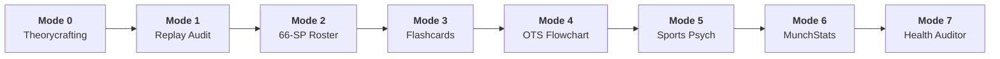

<div align="center">

# ⚡ BeRightVGC: Coach Porygon Runtime
### Autonomous Esports Intelligence, Scouting & Deterministic Turn-Simulation Runtime
**Engineered by [esquedev](https://github.com/esquedev) for Pokémon Champions (Regulation M-C)**

<p align="center">
  
  &nbsp;&nbsp;
  
  &nbsp;&nbsp;
  
</p>

[](https://github.com/esquedev/coach-porygon-vgc/actions/workflows/ci.yml)
[-10b981.svg)](tests/)
[](https://www.python.org/)
[-e11d48.svg)](data/MC_Available_Pokemon.csv)
[-06b6d4.svg)](assets/png_manifest.json)
[-10b981.svg)](pyproject.toml)
[](LICENSE)
[](LEGAL.md)

<p align="center">
  <b>100% Dependency-Free Core Engine</b> • <b>Official VGC Fixed-Point Damage Simulator</b> • <b>OWASP LLM01 Hardened</b><br/>
  <b>Bilingual Cyberpunk Command Center (EN / ES)</b> • <b>Showdown EV ↔ 66-SP Bijective Converter</b> • <b>GPU HiGHS Nash Matrices</b>
</p>

---

</div>

> [!NOTE]
> **Brand & Nominative Fair Use Notice:**  
> **BeRightVGC** (telemetry handle: `brightvgc`) is an esports intelligence suite created by **esquedev**. Its core execution engine, **Coach Porygon VGC**, is an independent, non-commercial open-source research platform and is **not affiliated with, endorsed, sponsored, or approved by Nintendo, Game Freak, or The Pokémon Company**. All Pokémon names, likenesses, and battle mechanics are referenced strictly under the legal doctrine of [Nominative Fair Use](LEGAL.md).

---

## 🌟 The Hook: Why BeRightVGC / Coach Porygon?

Most AI tools for competitive gaming suffer from two fatal vulnerabilities:
1. **Mental Math Hallucinations:** Generative LLMs invent illegal damage rolls, hallucinate impossible stat spreads, and miscalculate weather/terrain damage multipliers.
2. **Tactical Drift & Format Leaks:** General models frequently forget format rules (such as instantaneous Mega Evolution speed scaling or Psychic Terrain airborne exemptions) and suggest banned staples (`Urshifu`, `Flutter Mane`, `Amoonguss`).

**BeRightVGC bridges this gap with mathematical finality.** Instead of asking a generative model to compute damage in its head, BeRightVGC positions a **deterministic micro-simulation runtime built on Python standard library and GPU-accelerated payoff matrices**, delivering:
- 🎯 **Official VGC Micro-Simulator (`engine/turn_simulator.py`):** Fixed-point damage formula accuracy, dynamic speed recalculation, terrain/weather interactions, and branching minimax rolls.
- 📐 **66-Stat-Point (SP) Budget Calculator (`engine/sp_calculator.py`):** Mathematical validation with sequential floor rounding at Level 50, featuring seamless **1:1 bijective conversion with Pokémon Showdown EVs**.
- 🎲 **Von Neumann Nash Equilibrium Solver (`engine/tactics/`):** Simultaneous $5 \times 5$ action matrices, pure/mixed minimax strategies via HiGHS linear programming, and counterfactual equity loss ($\Delta V^*$) calculations.
- 🛡️ **OWASP LLM01 Hardening & Anti-Hallucination Scanner:** Permanent quarantine on non-format species and complete isolation of untrusted replay strings.
- 🖥️ **Bilingual Cyberpunk Command Center HUD (`assets/command_center.html`):** Standalone reactive dashboard with **916 curated SHA-256 assets**, live cognitive health tracking, tilt barometers, and 45-second interactive board sparring.

---

## 🏛️ Brand Architecture: esquedev × BeRightVGC × Coach Porygon

To maintain clear separation between organization, product line, and runtime code:

```
                            THE BERIGHTVGC ECOSYSTEM
                                       │
        ┌──────────────────────────────┴──────────────────────────────┐
        ▼                                                             ▼
 [STUDIO & ENGINEERING]                                    [PRODUCT & PLATFORM]
       esquedev                                                 BeRightVGC
 Lead architecture, AI system                              Competitive intelligence,
 design, and core research.                                scouting, and analytics suite
                                                           (Telemetry: brightvgc).
        │                                                             │
        └──────────────────────────────┬──────────────────────────────┘
                                       ▼
                         [DETERMINISTIC RUNTIME ENGINE]
                               coach-porygon-vgc
                    Official Level 50 turn simulator, 66-SP
                  calculator, GPU payoff matrices & CI/CD pipeline.
```

---

## ⚡ Quickstart (Clone & Run in 10 Seconds)

The core engine requires **zero third-party dependencies** at runtime. You only need standard Python 3.10+.

```bash
# 1. Clone the repository
git clone https://github.com/esquedev/coach-porygon-vgc.git
cd coach-porygon-vgc

# 2. Launch the Secure Local Command Center Backend
python engine/ui_server.py
```

Open your browser at **[`http://localhost:8000/assets/command_center.html`](http://localhost:8000/assets/command_center.html)** (or access `/es` for Spanish, `/en` for English).

> [!TIP]
> On Windows systems, you can double-click `start_command_center.cmd` to boot the web server instantly in loopback mode!

---

## 🎮 The 8 Operational Coaching Modes



| Mode | Capability | Core Engine / Rule | Example Prompt / CLI Action |
| :---: | :--- | :--- | :--- |
| **Mode 0** | **General Coaching & Meta Theorycrafting** | `engine_rules.md` | *"What is the optimal counter-lead against Rain Archaludon?"* |
| **Mode 1** | **Asynchronous Replay Breakdown** | `turn_simulator.py` + `telemetry.py` | *"Audit my replay vs Ash: Identify Turn 3 VP inflection point."* |
| **Mode 2** | **66-SP Deterministic Roster Engineering** | `sp_calculator.py` + `validate_roster.py` | *"Optimize 66-SP spread for Mega Charizard Y to survive Timid Specs Draco Meteor."* |
| **Mode 3** | **Interactive Board Sparring & Reflex Flashcards** | `scenarios_data.py` + `speed_duels_data.py` | *"Start a 45-Second flashcard scenario with unrevealed option evaluations."* |
| **Mode 4** | **Open Team Sheet (OTS) Swiss Flowcharting** | `munchstats_threat_engine.py` | *"Opponent OTS: Garchomp, Incineroar, Rillaboom, Primarina, Chandelure, Archaludon."* |
| **Mode 5** | **Cognitive Leak Eradication & Sports Psych** | `mistake_taxonomy.md` | *"Review my last 10 losses: Am I leaking VP due to Greed or Autopilot?"* |
| **Mode 6** | **MunchStats Tournament Meta Ingestion** | `munchstats_meta` + `/api/munchstats` | *"Crawl and cluster 2027 Nice Regional Masters top cut."* |
| **Mode 7** | **Release Health Auditor & Prompt Stress Evaluator** | `evals/evaluate_release_health.py` | `python evals/evaluate_release_health.py --verify` *(35 adversarial cases)* |

---

## 🧮 66-SP Math ↔ Pokémon Showdown EV Bijective Mapping

In Pokémon Champions Regulation M-C, trainers allocate **Stat Points (SP)** rather than legacy EVs. Because 1 SP adds exactly **+1 point** to a final Level 50 stat, our engine implements an exact bijective mathematical translation:

```math
\text{EV} = 4 + (\text{SP} - 1) \times 8 \quad (\text{for } \text{SP} \ge 1)
```

```math
\text{SP} = 1 + \left\lfloor \frac{\text{EV} - 4}{8} \right\rfloor \quad (\text{for } \text{EV} \ge 4)
```

<div align="center">

| Stat Points (SP) | Showdown EVs (Lv 50) | Stat Impact | Allocation Notes |
| :---: | :---: | :---: | :--- |
| **0 SP** | **0 EVs** | +0 | Base uninvested stat |
| **1 SP** | **4 EVs** | +1 | Initial 4-EV bump |
| **2 SP** | **12 EVs** | +2 | +8 EVs per subsequent point |
| **3 SP** | **20 EVs** | +3 | Efficient defensive threshold |
| **4 SP** | **28 EVs** | +4 | Speed creep tier |
| ... | ... | ... | ... |
| **32 SP** | **252 EVs** | +32 | **Single-Stat Hard Cap** |
| **Total: 66 SP** | **Total: 508 EVs** | +66 | **Mandatory Team Allocation Budget** |

</div>

---

## 📊 Publication-Grade Reporting Suite (`report-generator`)

BeRightVGC provides an autonomous visual publication engine for esports analytics, featuring 5 canonical report types:
1. **Tactical Replay Audit:** Simultaneous payoff matrix, turning point identification, and equity delta ($\Delta V^*$).
2. **Metagame & Swiss Intelligence:** Archetype clustering, Swiss attrition curves, and Day 1 $\to$ Day 2 conversion rates.
3. **Telemetry & Playstyle Diagnostics:** Longitudinal error clustering (`POS`, `TGT`, `MEC`, `SPD`) and cognitive driver analysis.
4. **Coach QA & Decision Audit:** Verifiable ground-truth benchmark comparing coaching recommendations with official damage calculations.
5. **Swiss Opponent Scouting & Caster Aid:** Level 50 speed ladders, matchup threat matrices, and broadcast cheat sheets.

Export seamlessly to self-contained HTML or print-ready PDF:
```bash
# Export tactical audit with Midnight Cyber preset
python main.py --demo --format html --theme midnight --output-dir reports/

# Export print-ready executive dossier to PDF
python main.py --demo --format pdf --theme editorial --output-dir reports/
```

---

## 🛡️ Security Posture & DevSecOps Hardening

```text
Security Architecture Overview:
├── Network Security     : Default binding strictly to 127.0.0.1 (SEC-01)
├── Cross-Origin Policy  : CORS restricted to localhost & local file:// null origins (SEC-02)
├── Document Root Guard  : HTTP 403 Forbidden on /.git, /.github, and trainer_profile.json (SEC-03)
├── SSRF & LFI Shield    : Strict HTTPS domain whitelist for tournament scrapers (SEC-04)
├── Asset Integrity      : 916 curated PNG assets tracked with SHA-256 hashes (SEC-05)
├── Resource Protection  : 5 MB payload cap preventing memory exhaustion DoS (SEC-06)
├── CSV Concurrency      : Thread-safe reentrant file locks preventing race conditions (SEC-07)
├── Anti-Hallucination   : Automated repo-wide scanner enforcing Regulation M-C species lock (SEC-08)
└── Static Analysis      : Automated GitHub CodeQL SAST scanning on Python & JS/TS
```

---

## 🧪 Testing & Verification Suite (247 Automated Tests)

Our test suite guarantees 100% deterministic reliability across all subsystems without external network calls:

```bash
# Run the complete test suite with colorized visual ANSI output:
.\run_tests.cmd          # On Windows Command Prompt / PowerShell
./run_tests.sh           # On macOS / Linux
```

```text
==============================================================================
  BERIGHTVGC / COACH PORYGON VGC — LOCAL CI/CD PIPELINE (FULL 5-PHASE RUNNER)
==============================================================================
[PHASE 0/5] Sanitizing Workspace and Garbage Collection... [OK]
[PHASE 1/5] Initializing Schema Templates... [OK]
[PHASE 2/5] Linting and Syntax Compilation (0 violations)... [OK]
[PHASE 3/5] Verifying AI Health Stress Audit (35 cases)... [OK]
[PHASE 4/5] Auditing Curated Assets (916 SHA-256 digests)... [OK]
[PHASE 5/5] Executing Full Test Suite (pytest with coverage parity)...
============================ 247 passed in 13.53s =============================
[PASS] ALL 5 CI/CD PIPELINE PHASES PASSED LOCALLY WITH ZERO ERRORS
```

---

## 🤝 Contributing

We welcome competitive players, prompt engineers, UI designers, and systems developers! Please review our **[`CONTRIBUTING.md`](CONTRIBUTING.md)** for our development lifecycle, contribution opportunity matrix, and coding standards.

---

## ⚖️ Intellectual Property, Fair Use & Legal Policy

Pokémon character names, species designs, battle mechanics, items, and trademarks are the intellectual property of **The Pokémon Company**, **Nintendo**, **Creatures Inc.**, and **Game Freak**.

- **Non-Commercial Esports Research:** BeRightVGC is an open-source, non-commercial analytical coaching and simulation framework created under Fair Use principles for competitive study and sports science research.
- **Original Curated Assets:** All creature sprites and icons are curated strictly for non-commercial identification under nominative fair use. No proprietary binary game code or ROM assets are redistributed.
- **Nominative Fair Use & Player Privacy:** For complete details on our legal defense, player opt-out / anonymization protocol, and commercialization limitations, please review **[`LEGAL.md`](LEGAL.md)**.

---

<div align="center">
  <sub>Built with mathematical rigor by <b>esquedev</b> for competitive VGC Champions worldwide.</sub>
</div>
