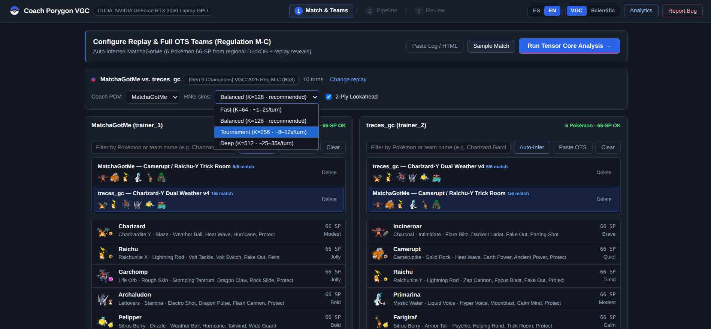
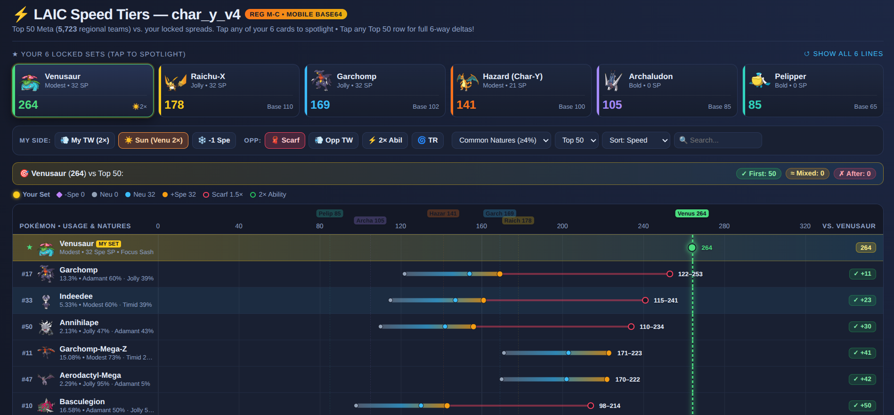

# Coach Porygon VGC 🦆⚡

[](LICENSE)
[](https://www.python.org/downloads/)
[](https://pytorch.org/)
[](https://duckdb.org/)
[-7c3aed.svg)](https://www.pokemon.com/)
[](tests/)

**An open-source GPU/CPU Tensor State Machine & Game-Theoretic Replay Coach for Competitive Pokémon VGC 4v4 Doubles (Regulation M-C / Pokémon Champions).**

Coach Porygon VGC turns any Pokémon Showdown replay and Open Team Sheet (66-SP) into an exact, turn-by-turn decision audit — simulating thousands of discrete-RNG battle timelines in parallel via PyTorch linear algebra, solving Zero-Sum Nash Equilibria & Logit QRE, and presenting plain-English (or Spanish) coaching advice alongside the live Showdown replay.

> **🇪🇸 Resumen Rápido (Español):** Coach Porygon VGC es un entrenador interactivo y motor matemático en GPU/CPU para **Pokémon VGC Dobles (Regulation M-C / Champions)**. Carga tu replay de Pokémon Showdown y tus equipos 66-SP (o usa **Auto-Inferir** desde DuckDB regional) para auditar cada turno con simulación RNG discreta, protección de peor escenario ($CVaR_{10}$), equilibrio de Nash y analítica de sesiones Bo3 — **100% bilingüe (ES / EN) y sin LLMs en el motor de cálculo**. En Windows, solo haz doble clic en **`start_replay_coach.bat`** para instalar todo automáticamente y abrir el servidor web local.

---

## 1. Install & Run the Replay Coach Web Server (Windows)

### Option A — 1-Click Windows Launcher (Recommended)
1. Install **[Python 3.10+](https://www.python.org/downloads/)** (check **"Add python.exe to PATH"** during setup).
2. Clone or download this repository:
   ```powershell
   git clone https://github.com/esquedev/coach-porygon-vgc.git
   cd coach-porygon-vgc
   ```
3. Double-click **[`start_replay_coach.bat`](start_replay_coach.bat)** (or run `.\start_replay_coach.bat` in PowerShell / CMD).

What `start_replay_coach.bat` does automatically:
- Creates `.venv` if it does not exist yet.
- Detects whether you have an NVIDIA GPU (`nvidia-smi`): installs **CUDA-accelerated PyTorch** automatically if present, or **CPU PyTorch** otherwise (and skips installation on subsequent runs for ~2s startup).
- Sets `PYTHONPATH=src;.` and boots the local Replay Coach Studio at **`http://127.0.0.1:8765/`** (opening your browser automatically).

*(You can pass flags straight through the launcher, e.g. `.\start_replay_coach.bat --device cpu --port 9000`.)*

### Option B — Manual Windows Setup (PowerShell)
```powershell
git clone https://github.com/esquedev/coach-porygon-vgc.git
cd coach-porygon-vgc

py -3 -m venv .venv
.\.venv\Scripts\Activate.ps1

# With NVIDIA GPU (CUDA 12.4):
pip install torch --index-url https://download.pytorch.org/whl/cu124
pip install -r requirements.txt

# Or CPU-only:
# pip install -r requirements.txt

$env:PYTHONPATH = "src;."
python -m apps.replay_coach.server
# Open http://127.0.0.1:8765/ in your browser
```

<details>
<summary><strong>Linux / macOS Installation & Server Flags</strong></summary>

```bash
git clone https://github.com/esquedev/coach-porygon-vgc.git
cd coach-porygon-vgc
python3 -m venv .venv
source .venv/bin/activate
pip install -r requirements.txt

PYTHONPATH=src:. python3 -m apps.replay_coach.server --device auto --port 8765
```
CLI flags for `apps.replay_coach.server`: `--host` (default `127.0.0.1`), `--port` (default `8765`), `--device {auto,cuda,cpu}`.

</details>

---

## 2. How the Linear Algebra Tensor Core Works

Traditional Pokémon simulators use slow Python object trees and nested `if/else` loops — impossible to evaluate across hundreds of simultaneous VGC action pairs (`26 × 26 = 676` joint lines per trainer) and hundreds of discrete RNG rolls per cell.

**Coach Porygon VGC** compiles the entire 4v4 Doubles board into **3 flat `float32` tensors** so every rule runs simultaneously across `[Strats_1 × Strats_2 × K]` parallel worlds:


| Tensor | Shape | What It Stores |
| :--- | :--- | :--- |
| **`F` (Field)** | `[Strats_1, Strats_2, K, 24]` | Weather & Terrain one-hots/timers, Trick Room, Gravity, Tailwind, Reflect/Light Screen/Aurora Veil, Mega flags. |
| **`P` (Roster)** | `[Strats_1, Strats_2, K, 8, 87]` | 8 fixed slots (`0–3` `trainer_1`, `4–7` `trainer_2`) × HP, L50 stats, boosts (`-6..+6`), status bits, dual-types, items, abilities, Mega payload. |
| **`M` (Moves)** | `[Strats_1, Strats_2, K, 8, 4, 59]` | 4 DuckDB-compiled move vectors per slot (BP, accuracy, priority, 18-type one-hot, multi-hit, contact/slicing/punch/pulse/bite/bullet flags). |

### Worked Example: One Branchless Operation (`Switch-In + Intimidate`)

Instead of branching with `if mon.switched:`, every game mechanic is a **matrix multiplication or binary gate `g ∈ {0, 1}` operating across rows simultaneously**. Below, Pokémon and Item sprites replace raw matrix rows so you can see exactly how **Phase 1 (Switch-In + Intimidate)** resolves in one GPU pass:


1. **Permutation Matrix Multiply (`Π · P_before = P_after`):** Selecting *Switch Slot A → Bench 1* swaps Row `0` (`Charizard`) and Row `2` (`Incineroar`) via permutation matrix `Π`, while the persistence mask `m` zeroes temporary stat boosts (`SpA +2 → 0`) on the outgoing Pokémon in the exact same multiply.
2. **Masked Vector Addition (`Intimidate + Defiant + White Herb`):** Opposing Active Rows `r4` (`Kingambit`) and `r5` (`Sneasler`) receive `-1 Atk` from `Incineroar`, then branchless counter-gates add `+2 Atk` for `Defiant` and restore `< 0 → 0` + `Unburden (2× Speed)` for `White Herb` — letting the GPU automatically spot and penalize bad Intimidate traps in Nash/IEDS!

**Why this extrapolates cleanly to the whole engine:**
- **Mega Evolution (Phase 2, Priority `+5.5`):** Exact same blend formula (`Stats' = (1 - m)·Stats + m·MegaStats`) with instantaneous Regulation M-C speed recalculation.
- **Type Effectiveness (Phase 4):** Bilinear matrix contraction across the `18 × 18` type chart (`m_typeᵀ · T · t_1 × m_typeᵀ · T · t_2`), plus exact weather stat buffs (Rock `1.5× SpD` in Sand, Ice `1.5× Def` in Snow).
- **Discrete RNG & Downside Risk (`CVaR_10`):** Zero expected-value smearing — every thread `k` spins a SplitMix64 Dual-Draw wheel for accuracy, crits, and the 16 cartridge damage rolls (`{85..100}/100`), then ranks plays by $U_{\text{risk}} = 0.75\,\mathbb{E}[U] + 0.25\,CVaR_{0.10}[U]$ through **IEDS → Zero-Sum Nash LP → Logit QRE** (plus optional **Selective 2-Ply Lookahead** on the Strict-IEDS core).

---

## 3. Capabilities & Visual Showcase

### A. Replay Coach Studio (`apps/replay_coach/`)
A 3-step guided local web app featuring:
- **Step 1 — Match & 66-SP OTS Setup:** Drag-and-drop Showdown `.html`/`.log` replays, searchable DuckDB team library with sprites, **1-Click `Auto-Infer (DuckDB)`** to reconstruct unrevealed opponent 66-SP sets from `34,334` regional tournament slots, and optional **`2-Ply (Turn+2)`** lookahead toggle.
- **Step 2 — Live Tensor Core Execution Console:** Real-time SSE phase-by-phase log (`COMPILE → PRUNE → PHASE 1–5 → IEDS → PLY_2 → NASH_QRE → VERDICT`) with live Stop / Resume / Restart controls.
- **Step 3 — Synchronized Showdown Review & Bo3 Session Analytics:** Official Showdown battle playback synced to turn verdicts (`!!`, `!`, `?!`, `?`, `??`), **4-profile bilingual switcher (`ES`/`EN` × `VGC`/`Scientific`)**, team CSV telemetry export, **Bo3 Session Analytics Dashboard** (Win Rate, Accuracy Trend, Mistakes by Phase, Turn 1 Lead W-L), and 1-click diagnostic **Bug Log Generator**.

| Step 1 — Match & Full OTS Setup | Step 3 — Synchronized Replay & Coach Advice |
| :---: | :---: |
|  |  |

---

### B. Offline Mobile-Portable Tournament Tools (Base64 HTMLs)
Coach Porygon generates zero-dependency, single-file Base64 HTML tools you can drop directly onto your phone for offline Regional prep:

| Interactive Speed Tiers (`char_y_v4`) | Interactive Damage & KO Matrix (`char_y_v4` vs. Top 50) |
| :---: | :---: |
|  |  |
| [Open / Download `speed_tiers_char_y_v4_mobile.html`](docs/examples/speed_tiers_char_y_v4_mobile.html) | [Open / Download `damage_calcs_char_y_v4_mobile.html`](docs/examples/damage_calcs_char_y_v4_mobile.html) |

---

### C. Antigravity IDE Agentic Coaching Workflows
Built-in workspace rules ([`AGENTS.md`](AGENTS.md)) and skills turn Antigravity IDE into a Regulation M-C Head Coach (`[SESSION: TRAINER]`) grounded strictly in in-memory DuckDB (`pokedex`, `moves`, `items`, `abilities`, `tournament_team_slots`):
- **`team-modes-and-preview-playbook`:** Computes all 15 4-mon modes and 15 lead pairs for any 66-SP roster into a 90-second Team Preview Decision-Tree Playbook.
- **`battle-telemetry-feedback`:** Extracts Showdown battle logs into `data/telemetry/<team>/battles_telemetry.csv` with standardized coaching audit tags (`[LEAD_EVAL]`, `[MEGA_DECISION]`, `[VARIANCE_AUDIT]`, `[NASH_REGRET]`).


---

## 4. CLI Advisor & Test Suite

### Command-Line Advisor (`engine.cli`)
```bash
PYTHONPATH=src python3 -m engine.cli \
  --paste data/teams/char_y_v4.txt \
  --log battle.log \
  --pov "YourShowdownName" \
  --sims 256 \
  --lang en \
  --style vgc \
  --verbosity coach
```
*(Supports `--lang {es,en}`, `--style {vgc,scientific}`, and `--verbosity {coach,scientific}`.)*

### Verification (`115/115` Pytest Passing)
```powershell
# Windows (PowerShell)
$env:PYTHONPATH = "src;."
.\.venv\Scripts\pytest.exe tests/ -q

# Linux / macOS
PYTHONPATH=src:. .venv/bin/pytest tests/ -q
```

---

## 5. License

Coach Porygon VGC is open-source software licensed under the **GNU Affero General Public License v3.0 (AGPLv3)**. See [`LICENSE`](LICENSE) for details.
