# Coach Porygon VGC (`coach-porygon-vgc`)

[](https://www.gnu.org/licenses/agpl-3.0)
[](https://www.python.org/downloads/)
[](https://pytorch.org/)

**A High-Performance GPU/CPU Tensor State Machine & Tournament Simulation Engine for Pokémon VGC 4v4 Doubles (Regulation M-C).**

---

## 1. Overview

Competitive Pokémon VGC 4v4 Doubles presents a severe combinatorial challenge: within a 45-second tournament clock, players navigate an action space of $26 \times 26 = 676$ joint choices per turn (evaluating up to $456,976$ joint board outcomes per turn across $K=16$ discrete cartridge damage rolls).

`vgc_tensor_core` translates the official cartridge turn execution pipeline into **dense linear algebra and tensor contractions**. By eliminating scalar object allocations and operating across batch dimensions, the engine enables:
- **Instantaneous Grid Evaluation:** Computes all legal moves and damage distributions across the full $26 \times 26$ grid.
- **Monte Carlo Timeline Expansion:** Evaluates $K=16$ discrete cartridge damage rolls $\{0.85, 0.86, \dots, 1.00\}$ to calculate empirical KO probabilities $P(\text{faint}) \in [0.0, 1.0]$.
- **Hardware Agnostic:** Seamless execution on both PyTorch CUDA devices (e.g. RTX 3060) and vectorized CPU NumPy environments.
- **Battle-Tested Invariants:** 50,000-turn adversarial fuzzer verified with zero NaNs, Infs, or invalid HP states.

---

## 2. The 5 Synchronization Barriers of an Official VGC Turn

```mermaid
flowchart TD
    State["Initial State Vectors [F, P, M] & Action Choices [p1, p2]"] --> B1
    subgraph PreAttack ["Phases 1–3: Pre-Attack Synchronization"]
        B1["Phase 1 — Barrier 1: Switches & Entry Abilities (+6)<br>• Active/Bench permutation swap<br>• Speed-sorted Weather/Terrain & Intimidate triggers"]
        B2["Phase 2 — Barrier 2: Mega Evolution (+5.5)<br>• In-place 5-stat & ability interpolation<br>• Instantaneous Speed recalibration (Regulation M-C)<br>• Speed-sorted Mega Entry Abilities"]
        B3["Phase 3 — Barrier 3: Speed, Priority & Jitter Sort<br>• Effective Speed S_eff & Effective Priority p_eff<br>• Speed tie detection & seeded +/-0.01 jitter<br>• execution_order = argsort(Score)"]
        B1 --> B2 --> B3
    end
    B3 --> B4
    subgraph AttackCascade ["Phase 4: 4-Step Vectorized Attack Cascade"]
        B4["Phase 4: 4-Step Vectorized Attack Loop<br>• Gating: Faint & Flinch checks<br>• Targeting: Follow Me & KO Redirection XOR<br>• Damage: Level 50 formula x K=16 Monte Carlo rolls<br>• Defenses: Focus Sash / Sturdy 1 HP clamping<br>• Recoil (-10% Life Orb, -33% moves) & Drain (+75%)<br>• Mid-Turn Pivots (U-turn) & Forced Switches (Dragon Tail)"]
    end
    B4 --> B5
    subgraph EndOfTurn ["Phase 5: End-of-Turn Resolution"]
        B5["Phase 5: End-of-Turn Residuals & Replacements<br>• Chip Damage: Sandstorm, Burn (-1/16), Poison (-1/8), Toxic<br>• Healing: Grounded Grassy Terrain (+1/16) & Leftovers (+1/16)<br>• Decrements: Weather, Terrain, Tailwind, Trick Room, Screens<br>• Protect streak reset if unused<br>• Compiler Tactical Prior Auto-Replacements for fainted slots<br>• Match termination & winner evaluation"]
    end
    B5 --> Out["End-of-Turn State Result [Next_F, Next_P, Next_M, StepTelemetry]"]
```



---

## 3. Quickstart & Installation

```bash
# 1. Clone repository
git clone https://github.com/esquedev/coach-porygon-vgc.git
cd coach-porygon-vgc

# 2. Setup virtual environment
python -m venv .venv
# Windows PowerShell:
.\.venv\Scripts\Activate.ps1
# Linux/macOS:
source .venv/bin/activate

# 3. Editable installation with developer dependencies
pip install -e ".[dev]"

# 4. Run the interactive live demo
python vgc_tensor_core/demo.py
```

---

## 4. Running Verification & Invariant Suites

```bash
# Run Milestone 1-5 Unit Tests
python -m unittest discover -s vgc_tensor_core/tests/ -p "test_milestone*.py"

# Run 50,000-Turn Adversarial Invariant Fuzzer (CUDA/CPU)
python vgc_tensor_core/tests/test_adversarial_fuzzer.py

# Run GPU Roofline Latency & Throughput Benchmark
python vgc_tensor_core/benchmarks/roofline_benchmark.py
```

---

## 5. Tensor Geometry & State Dimensions

The engine maintains a minimal, cache-aligned state vector partitioned into three primary tensors:
