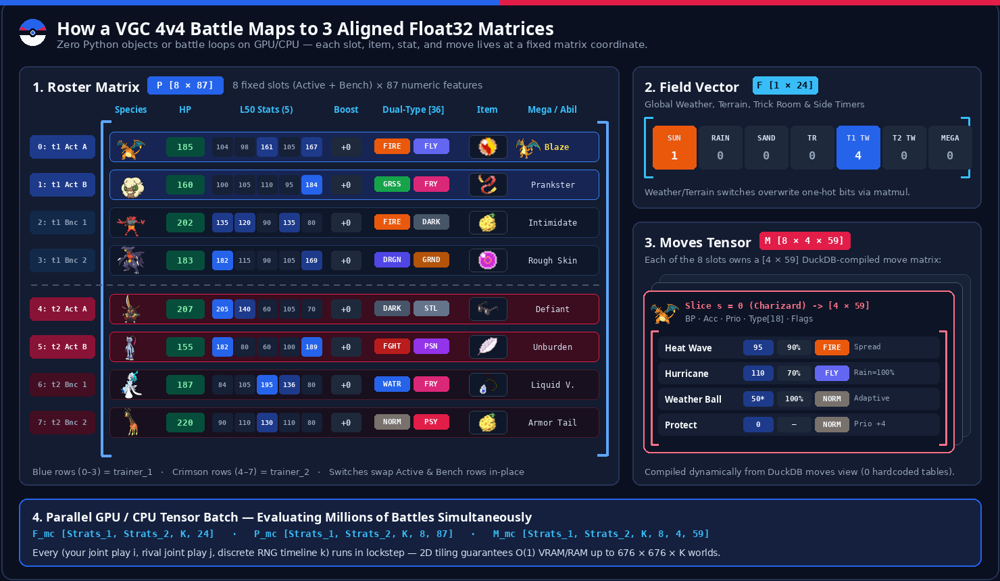
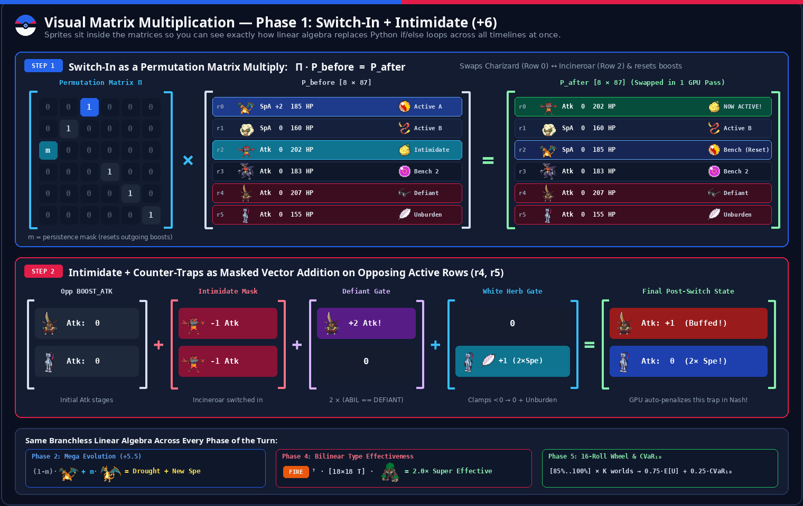
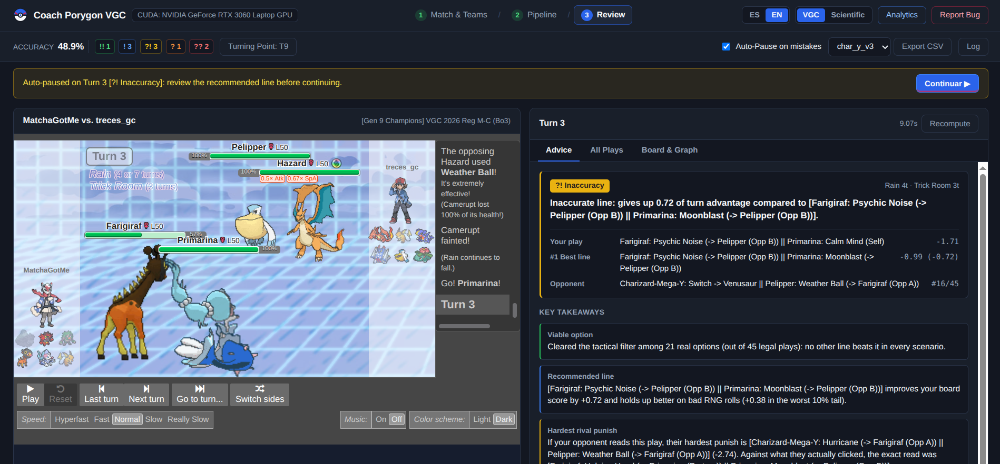
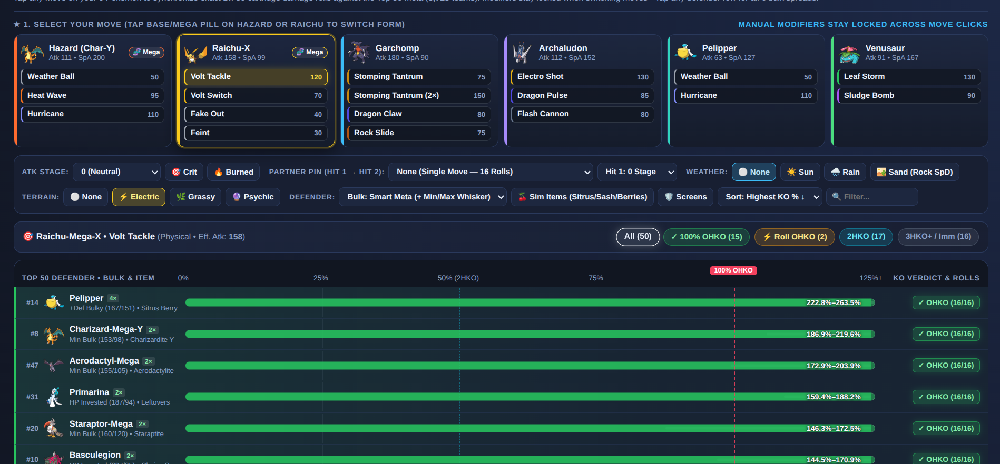

# Coach Porygon VGC 🦆⚡

[](LICENSE)
[](https://www.python.org/downloads/)
[](https://pytorch.org/)
[](https://duckdb.org/)
[-7c3aed.svg)](https://www.pokemon.com/)
[](tests/)

**An open-source GPU/CPU Tensor State Machine & Game-Theoretic Replay Coach for Competitive Pokémon VGC 4v4 Doubles (Regulation M-C / Pokémon Champions).**

Coach Porygon VGC turns any Pokémon Showdown replay and Open Team Sheet (66-SP) into an exact, turn-by-turn decision audit — simulating thousands of discrete-RNG battle timelines in parallel via PyTorch linear algebra, solving Zero-Sum Nash Equilibria & Logit QRE, generating **zero-AI offline mobile Base64 Speed Tiers & Damage Matrices**, and presenting plain-English (or Spanish) coaching advice alongside the live Showdown replay.

> **🇪🇸 Resumen Rápido (Español):** Coach Porygon VGC es un entrenador interactivo y motor matemático en GPU/CPU para **Pokémon VGC Dobles (Regulation M-C / Champions)**. Carga tus replays Bo1/Bo3 de Pokémon Showdown y tus equipos 66-SP (o resuelve los SPs rivales exactos con `smogon/damage-calc` Champions) para auditar cada turno con simulación RNG discreta, protección de peor escenario ($CVaR_{10}$), equilibrio de Nash, **Herramientas Prep Base64 offline (Velocidades y Matriz de Daño sin IA)** y analítica de sesiones Bo3 — **100% bilingüe (ES / EN) y sin LLMs en el motor de cálculo**. En Windows haz doble clic en **`start_replay_coach.bat`** (o compila **`CoachPorygonStudio.exe`**); en Linux/macOS ejecuta **`./start_replay_coach.sh`** — ambos crean y activan `.venv` automáticamente sin tocar tu Python del sistema.

---

## 1. Install & Run the Replay Coach Web Server (Windows, Linux & macOS)

### Option A — 1-Click Isolated `.venv` Launchers (Recommended)
1. Install **[Python 3.10+](https://www.python.org/downloads/)** (on Windows, check **"Add python.exe to PATH"**).
2. Clone or download this repository:
   ```bash
   git clone https://github.com/esquedev/coach-porygon-vgc.git
   cd coach-porygon-vgc
   ```
3. Launch with **automatic isolated `.venv` creation & activation** (never touches system Python packages):
   - **Windows (Batch):** Double-click **[`start_replay_coach.bat`](start_replay_coach.bat)** (or run `.\start_replay_coach.bat`).
   - **Linux / macOS (Bash):** Run **`./start_replay_coach.sh`**.
   - **Windows Native Launcher (`.exe`):** Build or download the lightweight **`CoachPorygonStudio.exe`** (`~8 MB`, see Option B below) and double-click it inside the repo folder.

What every launcher does automatically:
- Creates and activates an isolated project **`.venv`** on first run (never pollutes system-wide Python).
- Checks a SHA-256 stamp of `requirements.txt` (`.venv/.requirements.sha256`) plus full core imports (`torch`, `numpy`, `scipy`, `duckdb`, `py_mini_racer`) so dependency updates sync automatically while subsequent launches boot in ~2s.
- Auto-detects NVIDIA GPUs (`nvidia-smi`) to install **CUDA 12.4 PyTorch**, or **CPU / Apple Silicon PyTorch** otherwise.
- Sets `PYTHONPATH` (`src;.` / `src:.`), starts Replay Coach Studio at **`http://127.0.0.1:8765/`**, and opens your browser automatically.

*(Pass server flags straight through any launcher, e.g. `./start_replay_coach.sh --device cpu --port 9000` or `.\start_replay_coach.bat --port 9000`.)*

### Option B — Windows No-Git 1-Click Release Bundle (`CoachPorygonStudio.exe`)
For Windows users who prefer not to use `git`, download **`CoachPorygonVGC-windows-x64.zip`** from the **[GitHub Releases](https://github.com/esquedev/coach-porygon-vgc/releases/latest)** page, extract it, and double-click **`CoachPorygonStudio.exe`** (`~8 MB`, built automatically on `windows-latest` via [`.github/workflows/build-windows-launcher.yml`](.github/workflows/build-windows-launcher.yml) whenever a `v*` tag is pushed).

Instead of shipping a bloated 3 GB CPU-only PyTorch monolith, `CoachPorygonStudio.exe` wraps the pure-stdlib launcher ([`apps/replay_coach/launcher_entry.py`](apps/replay_coach/launcher_entry.py)) with a custom Great Ball icon ([`assets/coach_porygon.ico`](assets/coach_porygon.ico)) and bootstraps `.venv` with the user's exact GPU:
```powershell
# Or compile locally on Windows:
pip install pyinstaller
python scripts/build_windows_launcher.py
# Output: dist\CoachPorygonStudio.exe
```

### Option C — Manual Setup (PowerShell / Bash)
```powershell
git clone https://github.com/esquedev/coach-porygon-vgc.git
cd coach-porygon-vgc

py -3 -m venv .venv
.\.venv\Scripts\Activate.ps1

# With NVIDIA GPU (CUDA 12.4):
pip install torch --index-url https://download.pytorch.org/whl/cu124
pip install -r requirements.txt

# Or CPU-only:
# pip install -r requirements.txt

$env:PYTHONPATH = "src;."
python -m apps.replay_coach.server
# Open http://127.0.0.1:8765/ in your browser
```

<details>
<summary><strong>Linux / macOS Installation & Server Flags</strong></summary>

```bash
git clone https://github.com/esquedev/coach-porygon-vgc.git
cd coach-porygon-vgc
python3 -m venv .venv
source .venv/bin/activate
pip install -r requirements.txt

PYTHONPATH=src:. python3 -m apps.replay_coach.server --device auto --port 8765
```
CLI flags for `apps.replay_coach.server`: `--host` (default `127.0.0.1`), `--port` (default `8765`), `--device {auto,cuda,cpu}`.

</details>

---

## 2. How the Linear Algebra Tensor Core Works

Traditional Pokémon simulators use slow Python object trees and nested `if/else` loops — impossible to evaluate across hundreds of simultaneous VGC action pairs (`26 × 26 = 676` joint lines per trainer) and hundreds of discrete RNG rolls per cell.

**Coach Porygon VGC** compiles the entire 4v4 Doubles board into **3 flat `float32` tensors** so every rule runs simultaneously across `[Strats_1 × Strats_2 × K]` parallel worlds:



| Tensor | Shape | What It Stores |
| :--- | :--- | :--- |
| **`F` (Field)** | `[Strats_1, Strats_2, K, 24]` | Weather & Terrain one-hots/timers, Trick Room, Gravity, Tailwind, Reflect/Light Screen/Aurora Veil, Mega flags. |
| **`P` (Roster)** | `[Strats_1, Strats_2, K, 8, 88]` | 8 fixed slots (`0–3` `trainer_1`, `4–7` `trainer_2`) × HP, L50 stats, boosts (`-6..+6`), status/recharge bits, dual-types, items, abilities, Mega payload. |
| **`M` (Moves)** | `[Strats_1, Strats_2, K, 8, 4, 60]` | 4 DuckDB-compiled move vectors per slot (BP, accuracy, priority, 18-type one-hot, multi-hit, recharge/contact/slicing/punch/pulse/bite/bullet flags). |

### Worked Example: One Branchless Operation (`Switch-In + Intimidate`)

Instead of branching with `if mon.switched:`, every game mechanic is a **matrix multiplication or binary gate `g ∈ {0, 1}` operating across rows simultaneously**. Below, Pokémon and Item sprites replace raw matrix rows so you can see exactly how **Phase 1 (Switch-In + Intimidate)** resolves in one GPU pass:



1. **Permutation Matrix Multiply (`Π · P_before = P_after`):** Selecting *Switch Slot A → Bench 1* swaps Row `0` (`Charizard`) and Row `2` (`Incineroar`) via permutation matrix `Π`, while the persistence mask `m` zeroes temporary stat boosts (`SpA +2 → 0`) on the outgoing Pokémon in the exact same multiply.
2. **Masked Vector Addition (`Intimidate + Defiant + White Herb`):** Opposing Active Rows `r4` (`Kingambit`) and `r5` (`Sneasler`) receive `-1 Atk` from `Incineroar`, then branchless counter-gates add `+2 Atk` for `Defiant` and restore `< 0 → 0` + `Unburden (2× Speed)` for `White Herb` — letting the GPU automatically spot and penalize bad Intimidate traps in Nash/IEDS!

**Why this extrapolates cleanly to the whole engine:**
- **Mega Evolution (Phase 2, Priority `+5.5`):** Exact same blend formula (`Stats' = (1 - m)·Stats + m·MegaStats`) with instantaneous Regulation M-C speed recalculation.
- **Type Effectiveness (Phase 4):** Bilinear matrix contraction across the `18 × 18` type chart (`m_typeᵀ · T · t_1 × m_typeᵀ · T · t_2`), plus exact weather stat buffs (Rock `1.5× SpD` in Sand, Ice `1.5× Def` in Snow).
- **Discrete RNG & Downside Risk (`CVaR_10`):** Zero expected-value smearing — every thread `k` spins a SplitMix64 Dual-Draw wheel for accuracy, crits, and the 16 cartridge damage rolls (`{85..100}/100`), then ranks plays by $U_{\text{risk}} = 0.75\,\mathbb{E}[U] + 0.25\,CVaR_{0.10}[U]$ through **IEDS → Zero-Sum Nash LP → Logit QRE** (plus optional **Selective 2-Ply Lookahead** on the Strict-IEDS core).

---

## 3. Capabilities & Visual Showcase

### A. Replay Coach Studio (`apps/replay_coach/`)
A 3-step guided local web app featuring:
- **Step 1 — Bo1 / Bo3 Bundle & Clamped 66-SP OTS Workbench:** Drag-and-drop **1 to 3 Showdown replays (`G1`/`G2`/`G3`)** together to auto-extract opponent `|showteam|` OTS and solve exact clamped 66-SP bounds (`[min_sp, max_sp]`) via the vendored offline **`smogon/damage-calc` Champions** engine (`mini-racer` / `quickjs`, zero Node.js required). Locked (`🔒`) and bounded stats cannot be overridden; adjust remaining unobserved SPs interactively with live Level 50 stat previews, searchable DuckDB team library with sprites, and optional **`2-Ply (Turn+2)`** lookahead toggle.
- **Step 2 — Live Tensor Core Execution Console:** Real-time SSE phase-by-phase log (`COMPILE → PRUNE → PHASE 1–5 → IEDS → PLY_2 → NASH_QRE → VERDICT`) with live Stop / Resume / Restart controls and seamless `G1`/`G2`/`G3` game switching.
- **Step 3 — Synchronized Showdown Review & Bo3 Session Analytics:** Official Showdown battle playback synced to turn verdicts (`!!`, `!`, `?!`, `?`, `??`), unified top player controls, **4-profile bilingual switcher (`ES`/`EN` × `VGC`/`Scientific`)**, team CSV telemetry export, **Bo3 Session Analytics Dashboard**, and 1-click diagnostic **Bug Log Generator**.
- **Topbar `Prep Tools` (`Herramientas Prep`) View — Zero-AI Offline Base64 Mobile Generator:** Pick any saved DuckDB roster or paste any Regulation M-C 66-SP team, choose `Top 20 / 35 / 50`, interactively preview **Speed Tiers** (exact 31-IV Champions Lv. 50 speeds + Base/Mega switchers + dynamic team speed-doubling toggles) and **Damage & KO Matrix** (pre-computed exact `smogon/damage-calc` Champions 16-roll tables across all **5 Weathers** `Clear/Sun/Rain/Sand/Snow`, all **5 Terrains** `None/Electric/Grassy/Psychic/Misty`, Spread vs. Single-Target, Helping Hand, Screens, Crit, Burn, Partner Double-Up, Focus Sash/Sitrus/Resist Berries/Terrain Seeds, and 7 legal `≤ 66 SP` bulk profiles), and 1-click download a portable single-file offline `.html` for your phone — **zero AI subscription required!**

| Step 1 — Match & Full OTS Setup | Step 3 — Synchronized Replay & Coach Advice |
| :---: | :---: |
|  |  |

---

### B. Zero-AI Automated Offline Mobile-Portable Prep Tools (Base64 HTMLs)
Generate zero-dependency, single-file Base64 HTML reports for **any** 6-Pokémon Regulation M-C team directly from the Studio **`Prep Tools`** view or via the headless CLI (`scripts/generate_prep_tools.py`) — powered 100% by in-memory DuckDB, local Base64 sprites, and vendored `smogon/damage-calc` Champions:

```bash
PYTHONPATH=src:. .venv/bin/python scripts/generate_prep_tools.py \
  --team data/teams/char_y_v4.txt \
  --top-n 50 \
  --out-dir reports/prep_tools \
  --lang en
```

| Interactive Speed Tiers (Mobile Base64) | Interactive Damage & KO Matrix (5 Weathers × 5 Terrains) |
| :---: | :---: |
|  |  |

---

### C. Antigravity IDE Agentic Coaching Workflows
Built-in workspace rules ([`AGENTS.md`](AGENTS.md)) and skills turn Antigravity IDE into a Regulation M-C Head Coach (`[SESSION: TRAINER]`) grounded strictly in in-memory DuckDB (`pokedex`, `moves`, `items`, `abilities`, `tournament_team_slots`):
- **`team-modes-and-preview-playbook`:** Computes all 15 4-mon modes and 15 lead pairs for any 66-SP roster into a 90-second Team Preview Decision-Tree Playbook.
- **`battle-telemetry-feedback`:** Extracts Showdown battle logs into `data/telemetry/<team>/battles_telemetry.csv` with standardized coaching audit tags (`[LEAD_EVAL]`, `[MEGA_DECISION]`, `[VARIANCE_AUDIT]`, `[NASH_REGRET]`).


---

## 4. Headless Bo1/Bo3 CLI & Test Suite

### Headless Bo1/Bo3 OTS 66-SP & Tensor Core CLI (`scripts/coach_bo3.py`)
```bash
PYTHONPATH=src:. python3 scripts/coach_bo3.py \
  --team data/teams/char_y_v4.txt \
  --replays g1.html g2.html g3.html \
  --rng-samples 128 \
  --lang en \
  --style vgc \
  --export-csv char_y_v4
```
*(Supports `--opp-ots <file>` for Bo1 replays without `|showteam|`, `--two-ply` for Selective 2-Ply Lookahead, `--no-sim` for instant 66-SP solving only, `--device {auto,cuda,cpu}`, `--lang {es,en}`, and `--style {vgc,scientific}`.)*

### Verification (`137/137` Pytest Passing)
```powershell
# Windows (PowerShell)
$env:PYTHONPATH = "src;."
.\.venv\Scripts\pytest.exe tests/ -q

# Linux / macOS
PYTHONPATH=src:. .venv/bin/pytest tests/ -q
```

---

## 5. License

Coach Porygon VGC is open-source software licensed under the **GNU Affero General Public License v3.0 (AGPLv3)**. See [`LICENSE`](LICENSE) for details.
