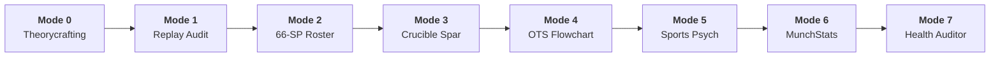

<div align="center">

# ⚡ Coach Porygon VGC
### Autonomous Esports Coaching, Scouting & Deterministic Turn-Simulation Runtime
**Designed for the Pokémon Champions (Regulation M-C) Competitive Ecosystem**

<p align="center">
  
  &nbsp;&nbsp;
  
  &nbsp;&nbsp;
  
</p>

[](https://github.com/unkil/coach-porygon-vgc/actions/workflows/ci.yml)
[](https://github.com/unkil/coach-porygon-vgc/actions/workflows/codeql.yml)
[](https://www.python.org/)
[-e11d48.svg)](data/MC_Available_Pokemon.csv)
[-06b6d4.svg)](assets/svg_manifest.json)
[-10b981.svg)](pyproject.toml)
[](LICENSE)
[](LEGAL.md)

<p align="center">
  <b>100% Dependency-Free Core Engine</b> • <b>Official VGC Fixed-Point Damage Simulator</b> • <b>OWASP LLM01 Hardened</b><br/>
  <b>Bilingual Cyberpunk Command Center (EN / ES)</b> • <b>Showdown EV ↔ 66-SP Bijective Converter</b>
</p>

---

</div>

> [!NOTE]
> **Independent Community Tool & Nominative Fair Use Notice:**  
> Coach Porygon VGC is an independent, non-commercial open-source esports research platform and is **not affiliated with, endorsed, sponsored, or approved by Nintendo, Game Freak, or The Pokémon Company**. All Pokémon names, creature likenesses, and battle mechanics are referenced strictly under the legal doctrine of [Nominative Fair Use](LEGAL.md).

---

## 🌟 The Hook: Why Coach Porygon VGC?

Most AI tools for competitive gaming suffer from two fatal flaws: **LLM mental math hallucinations** (inventing illegal damage rolls, guessing stat spreads, miscalculating weather multipliers) and **tactical drift** (forgetting format-specific rules like instantaneous Mega Evolution speed scaling or Psychic Terrain priority mechanics).

**Coach Porygon VGC bridges this gap.** Instead of asking a generative language model to calculate damage in its head, Coach Porygon provides a **deterministic micro-simulation runtime built on Python standard library**, backed by:
- 🎯 **Official VGC Micro-Simulator (`engine/turn_simulator.py`):** Fixed-point damage formula accuracy, dynamic speed recalculation, terrain/weather interactions, and branching minimax rolls.
- 📐 **66-Stat-Point (SP) Budget Calculator (`engine/sp_calculator.py`):** Mathematical validation with sequential floor rounding at Level 50, featuring seamless **1:1 bijective conversion with Pokémon Showdown EVs**.
- 🛡️ **OWASP LLM01 Prompt Injection Defense & Species Blacklist:** Permanent ban on non-format staples (`Flutter Mane`, `Urshifu`, `Ursaluna`, `Ogerpon`) and complete isolation of untrusted replay text.
- 🖥️ **Bilingual Cyberpunk Command Center HUD (`assets/command_center.html`):** Standalone 2 MB reactive single-page dashboard loaded with **539 vector SVGs**, live cognitive health tracking, tilt-o-meter, and 45-second interactive board sparring.

---

## ⚡ Quickstart (Clone & Run in 10 Seconds)

Coach Porygon VGC has **zero third-party dependencies** at runtime. You only need a standard Python 3.10+ installation.

```bash
# 1. Clone the repository
git clone https://github.com/unkil/coach-porygon-vgc.git
cd coach-porygon-vgc

# 2. Launch the Secure Local Command Center Backend
python engine/ui_server.py
```

Open your browser at **[`http://localhost:8000/assets/command_center.html`](http://localhost:8000/assets/command_center.html)** (or access `/es` for Spanish, `/en` for English).

> [!TIP]
> On Windows systems, you can also double-click `start_command_center.cmd` to boot the web server instantly in loopback mode!

---

## 🚀 Get the Best Out of This Repo With Your Setup

Coach Porygon VGC is built to adapt to your preferred AI agent, IDE, or development pipeline:

````carousel
```markdown
### 🌌 Setup 1: With Google Antigravity (Tier 1 Experience)
Antigravity provides the most immersive experience with Coach Porygon:
1. **Interactive Brain Artifacts:** View the Command Center directly within your chat session pane as an interactive HTML artifact with zero displacement animations.
2. **Slash Commands:**
   - Type `/plan` before complex teambuilding tasks to generate step-by-step 66-SP optimization roadmaps.
   - Type `/goal` for overnight meta-crawling or mass tournament parsing.
   - Type `/boost` for deep, multi-perspective masterclass replay breakdowns.
3. **Reactive Wakeup:** Subagents spawn autonomously in background tasks, notifying you automatically without polling loops.
```
<!-- slide -->
```bash
### ⚡ Setup 2: With Claude Code (Anthropic CLI)
If you operate from terminal with Claude Code:
1. **Context Loading:** Pass `.agents/rules/` into your session context:
   `claude --context .agents/rules/engine_rules.md`
2. **Terminal Verification:** Run the colorized ANSI test suite directly:
   `python tests/run_all_tests.py`
3. **Replay Breakdown Pipeline:** Pipe Showdown battle logs into Mode 1:
   `python engine/telemetry.py --mode personal --payload '{"replay": "..."}'`
```
<!-- slide -->
```markdown
### 🧠 Setup 3: With ChatGPT / Gemini Gems / Custom GPTs (Headless)
No local terminal? Turn any web LLM into an official Regulation M-C referee:
1. **System Prompt Grounding:** Copy the contents of `.agents/rules/engine_rules.md` and `.agents/rules/mistake_taxonomy.md` directly into your Custom GPT or Gemini Gem instructions.
2. **Zero Hallucination:** Prompt the LLM with your Showdown paste; it will strictly enforce the 66-SP cap and format item legality rules.
3. **Flashcards & Crucible:** Paste scenarios from `data/Crucible_Scenarios.csv` to drill turn execution directly in web chat.
```
<!-- slide -->
```python
### 💻 Setup 4: With GitHub Copilot / Cursor IDE
If you are developing or extending the codebase:
1. **Type-Safe Autocompletion:** Copilot utilizes the typed DTOs and abstract repositories in `engine/repositories.py`.
2. **Test-Driven Development (TDD):** Execute individual test modules rapidly with `python -m unittest tests/backend/test_sp_calculator.py`.
3. **PEP 8 Linting on Save:** The codebase strictly enforces PEP 8 and PEP 257 docstrings via `tests/lint/test_code_style.py`.
```
<!-- slide -->
```python
### 🌐 Setup 5: For Larger Ecosystems & REST API Integrations
Embed Coach Porygon as a deterministic microservice in larger software systems:
1. **Twitch / YouTube Tournament Streaming Overlays:**
   Poll `http://127.0.0.1:8000/api/telemetry` via an OBS Browser Source widget to render live win equity curves and speed tiers.
2. **Discord Coaching Bot Bridge:**
   Send POST requests to `/api/munchstats/crawl` with user queries to ingest tournament standings and post rich OTS infographics.
3. **Antigravity Sidecar Service:**
   Run `engine/ui_server.py` as a daemonized sidecar process communicating over JSON REST endpoints with CORS restricted strictly to localhost.
```
````

---

## 🎮 The 8 Operational Coaching Modes



| Mode | Capability | Core Engine / Rule | Example Prompt / CLI Action |
| :---: | :--- | :--- | :--- |
| **Mode 0** | **General Coaching & Meta Theorycrafting** | `engine_rules.md` | *"What is the optimal counter-lead against Rain Archaludon?"* |
| **Mode 1** | **Asynchronous Replay Breakdown** | `turn_simulator.py` + `telemetry.py` | *"Audit my replay vs Ash: Identify Turn 3 VP inflection point."* |
| **Mode 2** | **66-SP Deterministic Roster Engineering** | `sp_calculator.py` + `validate_roster.py` | *"Optimize 66-SP spread for Mega Charizard Y to survive Timid Specs Draco Meteor."* |
| **Mode 3** | **Interactive Crucible Sparring & Speed Duels** | `scenarios_data.py` + `speed_duels_data.py` | *"Start a 45-Second Crucible scenario with unrevealed option evaluations."* |
| **Mode 4** | **Open Team Sheet (OTS) Swiss Flowcharting** | `munchstats_scraper.py` | *"Opponent OTS: Garchomp, Incineroar, Rillaboom, Primarina, Chandelure, Urshifu."* |
| **Mode 5** | **Cognitive Leak Eradication & Sports Psych** | `mistake_taxonomy.md` | *"Review my last 10 losses: Am I leaking VP due to Greed or Autopilot?"* |
| **Mode 6** | **MunchStats Tournament Meta Ingestion** | `munchstats_scraper.py` + `/api/munchstats` | *"Crawl and cluster 2027 Nice Regional Masters top cut."* |
| **Mode 7** | **Release Health Auditor & Prompt Stress Evaluator** | `evals/run_static_checks.py` | `python evals/run_static_checks.py` *(26 adversarial tests)* |

---

## 🧮 66-SP Math ↔ Pokémon Showdown EV Bijective Mapping

In Pokémon Champions Regulation M-C, trainers allocate **Stat Points (SP)** rather than legacy EVs. Because 1 SP adds exactly **+1 point** to a final Level 50 stat, our engine implements an exact bijective mathematical translation:

```math
\text{EV} = 4 + (\text{SP} - 1) \times 8 \quad (\text{for } \text{SP} \ge 1)
```

```math
\text{SP} = 1 + \left\lfloor \frac{\text{EV} - 4}{8} \right\rfloor \quad (\text{for } \text{EV} \ge 4)
```

<div align="center">

| Stat Points (SP) | Showdown EVs (Lv 50) | Stat Impact | Allocation Notes |
| :---: | :---: | :---: | :--- |
| **0 SP** | **0 EVs** | +0 | Base uninvested stat |
| **1 SP** | **4 EVs** | +1 | Initial 4-EV bump |
| **2 SP** | **12 EVs** | +2 | +8 EVs per subsequent point |
| **3 SP** | **20 EVs** | +3 | Efficient defensive threshold |
| **4 SP** | **28 EVs** | +4 | Speed creep tier |
| ... | ... | ... | ... |
| **32 SP** | **252 EVs** | +32 | **Single-Stat Hard Cap** |
| **Total: 66 SP** | **Total: 508 EVs** | +66 | **Mandatory Team Allocation Budget** |

</div>

> [!NOTE]
> `engine/sp_calculator.py`, `engine/validate_roster.py`, and `engine/register_team.py` automatically detect and parse both SP format (`32 SpA / 32 Spe / 2 HP`) and standard Showdown EV export format (`252 SpA / 252 Spe / 12 HP`).

---

## 🛡️ Security Posture & DevSecOps Hardening

```text
Security Architecture Overview:
├── Network Security     : Default binding strictly to 127.0.0.1 (SEC-01)
├── Cross-Origin Policy  : CORS restricted to localhost & local file:// null origins (SEC-02)
├── Document Root Guard  : HTTP 403 Forbidden on /.git, /.github, and trainer_profile.json (SEC-03)
├── SSRF & LFI Shield    : Strict HTTPS domain whitelist for tournament scrapers (SEC-04)
├── Vector Asset Audit   : Zero active scripts (<script>) across 539 SVGs (SEC-05)
├── Resource Protection  : 5 MB payload cap preventing memory exhaustion DoS (SEC-06)
├── CSV Concurrency      : Thread-safe reentrant file locks preventing race conditions (SEC-07)
└── Static Analysis      : Automated GitHub CodeQL SAST scanning on Python & JS/TS
```

---

## 🧪 Testing & Verification Suite

Our test suite guarantees 100% deterministic reliability across all subsystems without requiring external network access:

```bash
# Run the complete test suite with colorized visual ANSI output:
.\run_tests.cmd          # On Windows Command Prompt / PowerShell
python tests/run_all_tests.py  # On macOS / Linux
```

```text
==============================================================================
  COACH PORYGON VGC — REGULATION M-C VERIFICATION & TEST RUNNER
==============================================================================
Total Species Audited:    363 (Missing: 0)
Total Items Audited:      85 (Missing: 0)
Total Mega Stones Audited:81 (Missing: 0)
Total SVGs Verified:      539 files on disk.
Well-formed XML Checks:   539 / 539 Valid XML.
Raster Bitmap Check:      0 Embedded Bitmaps (Target: 0).
Active Scripting Check:   0 Injected Scripts (Target: 0).
SHA-256 Digest Audit:     539 / 539 Cryptographic Hashes.
Manifest Generated:       assets\svg_manifest.json
==============================================================================
  [PASS] 35 Unit & Acceptance Tests (Repositories, Telemetry, SP Math, Roster)
  [PASS]  4 Packaging & Release Artifact Tests (pyproject.toml, HTML Footprint)
  [PASS]  7 Security Hardening Tests (CORS, 403 Path Shield, SSRF, DoS, Locking)
------------------------------------------------------------------------------
TEST SUITE EXECUTION SUMMARY:
  Total Executed: 46 tests
  Passed:         46 [OK]
  Failed:         0
  Execution Time: 1.96s
==============================================================================
✔ ALL SYSTEMS NOMINAL — 100% OF TESTS PASSED SUCCESSFULLY!
```

---

## 🤝 Contributing

We welcome competitive players, prompt engineers, UI designers, and systems developers! Please review our **[`CONTRIBUTING.md`](CONTRIBUTING.md)** for our development lifecycle, contribution opportunity matrix, and coding standards.

---

## ⚖️ Intellectual Property, Fair Use & Legal Policy

Pokémon character names, species designs, battle mechanics, items, and trademarks are the intellectual property of **The Pokémon Company**, **Nintendo**, **Creatures Inc.**, and **Game Freak**.

- **Non-Commercial Esports Research:** Coach Porygon VGC is an open-source, non-commercial analytical coaching and simulation framework created under Fair Use principles for competitive study and sports science research.
- **Original Vector Interpretations:** All 539 SVG vector crests are original geometric illustrations created specifically for this open-source project. No proprietary binary game code or ROM assets are redistributed.
- **Nominative Fair Use & Player Privacy:** For complete details on our nominative fair use defense, player opt-out / anonymization protocol, and commercialization limitations, please review **[`LEGAL.md`](LEGAL.md)**.

---

<div align="center">
  <sub>Built with mathematical rigor for competitive VGC Champions worldwide.</sub>
</div>
