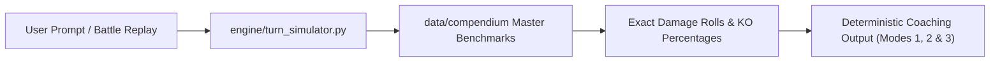

# 📚 Regulation M-C Compendium & Master Damage Reference

[-e11d48.svg)](../MC_Available_Pokemon.csv)

This directory serves as the **deterministic grounding compendium** for Coach Porygon VGC. Instead of relying on generative LLM arithmetic approximations, all damage rolls, stat bounds, and speed tiers in our coaching sessions and micro-simulations are strictly verified against these master references.

---

## 📁 Master Reference Files

### 1. [`Champions_Mechanics_Compendium.md`](Champions_Mechanics_Compendium.md)
The official competitive rulebook and mathematical mechanics specification for Regulation M-C:
* **The Official Damage Formula:** Step-by-step breakdown of base damage, level multipliers, base power scaling, attack/defense stage calculations, critical hit thresholds (1.5×), double-battle spread reduction (0.75×), STAB bonuses, and official fixed-point truncation rules.
* **Instantaneous Mega Evolution:** Mechanics governing turn-one speed recalculation and dynamic action queue reordering.
* **Climates & Terrains:** Complete priority interaction matrix (e.g., Psychic Terrain blocking grounded priority while airborne partners remain vulnerable).
* **66-Stat-Point (SP) Mathematical Model:** Formulas translating 66 SP across 6 stats with sequential floor rounding at Level 50 into Pokémon Showdown EVs.

### 2. [`M-C Calcs & Sets.md`](M-C%20Calcs%20&%20Sets.md)
A 2,380+ calculation master repository covering top metagame cores:
* **Master Speed Tier Benchmarks (Level 50):** Every tournament threat cataloged from 200 Spe (Timid Mega Gengar / Mega Aerodactyl) down to 20 Spe (Minimum Speed Torkoal under Trick Room).
* **Defensive Survival Spreads:** Optimal 66-SP spreads engineered to survive dominant offensive nukes (e.g. Mega Charizard Y Heat Wave in Sun, Mega Lucario Close Combat, Kingambit Kowtow Cleave).
* **Offensive Breakthrough Rolls:** Guaranteed 2HKO and OHKO benchmarks factoring items (Life Orb, Throat Spray, Charcoal, Mystic Water) and abilities (Protosynthesis, Transistor, Adaptability).

---

## 🎯 How the Engine Uses This Compendium

> [!NOTE]
> All calculation benchmarks are certified against official Pokémon Showdown damage engine parity. When adding new competitive sets, submit validated Showdown export pastes to [`engine/register_team.py`](../../engine/register_team.py).
