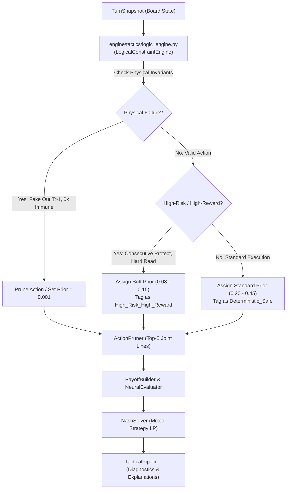

# Architectural Evaluation: Propositional Logic ($P \implies Q$) & Non-Binary Constraint Engines in VGC

**Document Version:** 1.0  
**Author:** Senior AI Systems & Software Engineer  
**Status:** Evaluation, Architecture Design & Implementation Strategy  
**Repository:** Coach Porygon VGC (Regulation M-C)

---

## 1. Executive Summary & Executive Decision

The objective of this evaluation is to study whether introducing a formal propositional logic module (*“If $P$ then $Q$”*) into Coach Porygon's tactical pipeline is viable, what its theoretical limits are, and how it should interface with the existing deterministic turn simulator (`turn_simulator.py`), action space pruner (`action_pruner.py`), and game-theoretic Nash equilibrium solver (`nash_solver.py`).

### Executive Recommendation: **Conditional Hybrid Model (Continuous Risk-Reward Engine)**

- **REJECTED (Pure Expert System for Move Selection):**  
  A classic 1980s rule-based system attempting to decide final turns through rigid rules (*"If opponent has Fire-type $X$ and I have Water-type $Y$, always click Water move $Z$"*) is completely rejected. In competitive VGC, this approach is obsolete, brittle, dogmatic, and immediately exploitable by human players because VGC is a **simultaneous-move, imperfect-information game**.
- **ACCEPTED & IMPLEMENTED (Continuous Constraint & Risk-Reward Engine):**  
  A dedicated logic module (`engine/tactics/logic_engine.py`) integrated as an intelligent pre-filter inside `engine/tactics/action_pruner.py`. Crucially, this engine does **not** treat tactical scenarios as binary ($0$ or $100\%$). Instead, it clearly bifurcates between:
  1. **Hard Mechanical Invariants (Physical Failures — Probability $0\%$):** Physical engine impossibilities that literally produce *"But it failed!"* in Showdown (e.g., `Fake Out` on active turns $> 1$, priority into grounded foes in Psychic Terrain).
  2. **Soft Tactical Constraints (Continuous High-Risk / High-Reward Continuum):** Highly unconventional or risky lines (e.g., consecutive `Protect` at $33\%$ success, dry hard switches on hard reads, or attacking into apparent resistances predicting an opponent switch) receive a **continuous risk-adjusted weight** rather than a hard zero, allowing the Nash equilibrium solver to discover positive-equity mixed strategies in desperate or high-leverage board states.

---

## 2. Theoretical Analysis: Propositional Logic vs. Game Theory in Simultaneous Doubles

### 2.1. The Simultaneity Fallacy of Naive "If-Then" Rules
Propositional logic operates under classical implication:
$$P \implies Q$$
In sequential games of perfect information (like Chess or Checkers), if state $P$ holds, optimal response $Q$ can be computed backward via Minimax tree search.

However, Pokémon VGC is played **simultaneously**:
1. At decision time $T_N$, Player 1 and Player 2 submit actions $(a_1, a_2)$ concurrently without seeing the opponent's choice.
2. Formulating a rule of the type:
   $$\text{OpponentUses}(\text{Earthquake}) \implies \text{MyAction} = \text{Protect}$$
   is an epistemological error: Player 1 cannot know $\text{OpponentUses}(\text{Earthquake})$ when choosing their action.
3. If Player 1 plays a deterministic pure strategy $Q$, Player 2 will anticipate it and play a counter-strategy $Q'$, destroying Player 1's equity.

### 2.2. Where Propositional Logic is Mathematically Exact
Logic rules are mathematically sound when applied to **game invariants and constraint satisfaction**:
1. **Precondition Truth Tables:** Move legality given current board state $S$.
2. **Deterministic Checkmate Invariants:** When an available joint action $a^*$ guarantees victory across all possible opponent responses:
   $$\forall a_2 \in \mathcal{A}_2, \quad \text{Payoff}(a^*, a_2) \ge \text{WinThreshold}$$
3. **Strict Dominance Pruning:** If action line $a_1$ is strictly dominated by $a_2$:
   $$\forall a_2^{opp}, \quad u(a_1, a_2^{opp}) < u(a_2, a_2^{opp}) \implies a_1 \text{ should not be recommended as primary}.$$

---

## 3. The Non-Binary Continuum: Hard Invariants vs. High-Risk / High-Reward

A critical pitfall in formal rule engines is treating all tactical warnings as absolute binary prohibitions ($0$ or $100$). In high-level tournament play, ostensibly "bad" or "irrational" moves frequently produce game-winning board states when executed as calculated hard reads:

```
[0.0 Probability]                                              [1.0 Probability]
<─── Physical Invariant ──────── High-Risk / High-Reward ────── Standard Safe ───>
    (Fake Out Turn > 1,            (Consecutive Protect,          (Spread STAB on
     0x Normal into Ghost)          Dry Switch on hard read,       double weakness)
                                    Prediction into switch-in)
```

### Classification of the Continuum:
1. **`Mechanically_Invalid` (Probability $0.0$, Hard Drop):**
   - Moves that fail due to cartridge physics (`Fake Out` on turn $> 1$, `Hypnosis` on Electric Terrain, priority moves against grounded targets in Psychic Terrain).
2. **`High_Risk_High_Reward` (Soft Prior Weight $0.05$ to $0.15$):**
   - Lines with high variance or non-standard execution that yield game-winning payoffs if the opponent commits to a predictable counter:
     - Consecutive `Protect` (mechanically succeeds $\approx 33\%$ of the time; game-saving when facing double lethal).
     - Dry hard switches into active attacks anticipating a status move or double-target on the partner.
     - Committing single-target attacks into a resisted slot anticipating a hard switch into a fragile sweeper.
3. **`Calculated_Risk` (Prior Weight $0.15$ to $0.30$):**
   - Attacks relying on $70\%-85\%$ accuracy moves (`Hydro Pump`, `Focus Blast`), or 50/50 prediction nodes.
4. **`Deterministic_Safe` (Prior Weight $0.30$ to $0.50$):**
   - Standard Minimax optimal lines maximizing guaranteed board equity.

---

## 4. Technical Architecture & Component Interaction



### Module Responsibilities:
- **`engine/tactics/logic_engine.py`**:
  - Encapsulates `LogicalConstraintEngine` and `ConstraintResult`.
  - Analyzes candidate move choices against field states (weather, terrain, screens, redirection, priority brackets).
  - Emits risk-reward scores, structural tags, and continuous prior modifiers.
- **`engine/tactics/action_pruner.py`**:
  - Consumes `LogicalConstraintEngine` to dynamically modulate `tactical_prior` without blindly deleting viable high-risk lines.
- **`engine/tactics/tactical_pipeline.py`**:
  - Incorporates constraint feedback to distinguish between blunders (`POS-01`, `TGT-01`) and legitimate high-risk tournament reads.

---

## 5. Maintenance Cost & Hallucination Mitigation

| Dimension | Risk Without Logic Engine | Mitigation via `logic_engine.py` |
| :--- | :--- | :--- |
| **Hallucination** | LLM coaching suggesting priority into Psychic Terrain or Fake Out on turn 3. | Deterministic rule verification flags physical failure immediately. |
| **Overfitting** | Brittle IF-THEN spaghetti rules requiring constant manual patches. | Rules derive strictly from grounded data tables (`BASE_STATS_DB`, `MOVE_DB`, `TYPE_CHART`). |
| **Dogmatism** | Engine never recommending risky game-saving plays in checkmate situations. | Continuous risk-reward modeling preserves high-risk/high-reward candidate actions in the Nash matrix. |

---

## 6. Implementation Milestones

1. **Milestone 1:** Implement `engine/tactics/logic_engine.py` with `LogicalConstraintEngine` and comprehensive test suite (`tests/testUT/tactics/test_LogicEngine.py`).
2. **Milestone 2:** Integrate soft-prior risk adjustment inside `engine/tactics/action_pruner.py`.
3. **Milestone 3:** Enrich `engine/tactics/tactical_pipeline.py` and `.agents/rules/mistake_taxonomy.md` with High-Risk/High-Reward tactical classifications.
4. **Milestone 4:** Run full CI/CD regression verification (`run_tests.cmd`).
