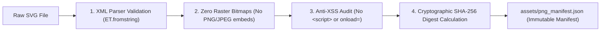

# 🎨 Coach Porygon VGC — Digital Vector Asset Library & IP Specification

[-e11d48.svg)](../../engine/verify_png_inventory.py)

This directory details the autonomous vector graphics inventory powering the Coach Porygon VGC Command Center HUD and competitive battle micro-simulator.

---

## 📦 1. Vector Asset Inventory Breakdown

Coach Porygon VGC houses **539 custom vector graphics** providing 100% visual coverage for the Pokémon Champions Regulation M-C competitive meta:

| Category | Directory Path | Count | Standard ViewBox | Purpose & Visual Style |
| :--- | :--- | :---: | :---: | :--- |
| **Species & Megas** | [`assets/sprites/`](../../assets/sprites/) | **371** | `0 0 120 120` | Geometric battle crests, authentic dual-type gradients, and tournament silhouettes for all legal Regulation M-C species and Mega Evolutions. |
| **Competitive Items** | [`assets/items/`](../../assets/items/) | **85** | `0 0 100 100` | High-recognition vector emblems for competitive hold items (Life Orb, Focus Sash, Choice Specs), berries, and terrain seeds. |
| **Mega Stones** | [`assets/megastones/`](../../assets/megastones/) | **81** | `0 0 100 100` | Radiant aura marble orbs featuring the iconic double-helix DNA crest for every certified Mega Stone. |
| **UI Badges & Icons** | [`assets/icons/`](../../assets/icons/) | **2+** | `0 0 100 100` | Cyberpunk HUD crests including the Pokéball badge and the glowing Mega Evolution sigil. |

---

## 🔒 2. Technical Standards & Security Architecture

Every SVG asset in this repository is strictly audited by our automated curator pipeline ([`engine/verify_png_inventory.py`](../../engine/verify_png_inventory.py)):

1. **100% Pure Vector Graphics:**
   - Every file on disk is authentic, scalable XML vector code.
   - **Zero Raster Contamination:** Files containing `data:image/png`, `data:image/jpeg`, or `<image ` tags are rejected immediately by CI.
2. **Anti-XSS & Script Injection Shield (SEC-05):**
   - Active content, `<script>` tags, and inline event handlers (`onload=`, `onerror=`, `onclick=`, `javascript:`) are strictly forbidden and audited in every test run.
3. **Cryptographic SHA-256 Tamper-Proofing:**
   - The unified manifest ([`assets/png_manifest.json`](../../assets/png_manifest.json)) records an immutable 64-character SHA-256 hash for every asset. Any unauthorized modification or corruption is detected immediately during test execution.

---

## ⚖️ 3. Intellectual Property (IP) & Fair Use Disclaimer

All Pokémon character names, creature silhouettes, battle concepts, and trademarks are the intellectual property of **The Pokémon Company**, **Nintendo**, **Game Freak**, and **Creatures Inc.**.

* **Non-Commercial Open-Source Project:** Coach Porygon VGC is an open-source, non-commercial analytical coaching and simulation framework created under Fair Use principles solely for competitive study and sports science research.
* **Original Geometric Interpretations:** All SVG assets contained in this directory are original, programmatic vector interpretations authored specifically for this open-source tool. No proprietary binary game code, ROM assets, or card game graphics are redistributed.
* **Community Parity:** Competitive identifiers and shorthand codes adhere strictly to standard open-source conventions maintained by the Pokémon Showdown community.
